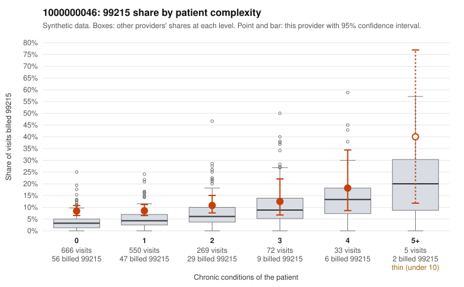

# 1000000046: 1000000046: too few returned records to judge

**Leaning (advisory):** Inconclusive

## Why

1000000046 billed 99215 on 9.3% of 1,595 claims against an expected 4.3% given patient complexity (risk-adjusted score 4.33; plain z-score vs peers 0.60). 69% of this provider's 99215 claims were on patients with 0 or 1 chronic conditions. Records came back for 45 claims. Of 18 documented 99215 claims, 6 (33%) were documented below the billed level, against 32% for the comparison providers. Note checks on 45 returned notes (share showing each sign): problems 44%, late 4%, unsigned 0%, data 0%, bulk created 0%, paste heavy 0%. 1 of 37 notes claiming moderate-or-higher data reviewed had no lab or test line on the claim. The evidence does not support a call either way yet. Examples: C0022024: billed 99215; documented MDM level moderate, 30 minutes. C0022229: billed 99215; documented MDM level moderate, 31 minutes. C0021605: billed 99215, patient aged 47 with 1 chronic condition(s) (obesity). C0021691: billed 99215, patient aged 57 with 0 chronic condition(s).

## Evidence chart

## Cited claims

`C0022024`, `C0022229`, `C0021605`, `C0021691`

## Suggested next steps

- 45 charts came back but do not settle it: request a targeted sample of 99215 charts, starting with C0022024, C0022229, C0021605.
- Re-check after the targeted charts arrive; do not call upcoding or a sicker panel on this evidence alone.

---
Citations checked: 4/4 valid. Synthetic data. The leaning is advisory; the flag comes from the statistical screen, and no clinical documentation is available beyond the sampled records-review facts shown in the packet.
