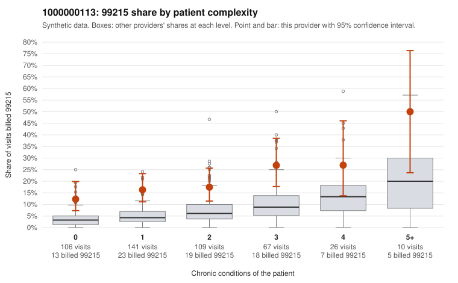

# 1000000113: 1000000113: too few returned records to judge

**Leaning (advisory):** Inconclusive

## Why

1000000113 billed 99215 on 18.5% of 459 claims against an expected 5.5% given patient complexity (risk-adjusted score 5.43; plain z-score vs peers 2.55). 42% of this provider's 99215 claims were on patients with 0 or 1 chronic conditions. Records came back for 30 claims. Of 6 documented 99215 claims, 1 (17%) were documented below the billed level, against 32% for the comparison providers. Note checks on 30 returned notes (share showing each sign): problems 30%, late 7%, unsigned 0%, data 0%. No audit trail was received. 0 of 15 notes claiming moderate-or-higher data reviewed had no lab or test line on the claim. The evidence does not support a call either way yet. Examples: C0046303: billed 99215, patient aged 43 with 1 chronic condition(s) (asthma); documented MDM level moderate, 34 minutes. C0045954: billed 99215, patient aged 18 with 0 chronic condition(s). C0045989: billed 99215, patient aged 43 with 0 chronic condition(s).

## Evidence chart

## Cited claims

`C0046303`, `C0045954`, `C0045989`

## Suggested next steps

- 30 charts came back but do not settle it: request a targeted sample of 99215 charts, starting with C0046303, C0045954, C0045989.
- Re-check after the targeted charts arrive; do not call upcoding or a sicker panel on this evidence alone.

---
Citations checked: 3/3 valid. Synthetic data. The leaning is advisory; the flag comes from the statistical screen, and no clinical documentation is available beyond the sampled records-review facts shown in the packet.
