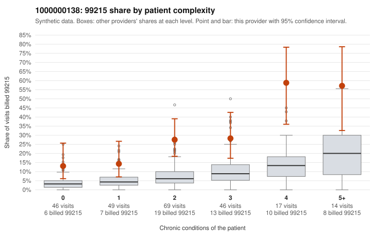

# 1000000138: 1000000138: too few returned records to judge

**Leaning (advisory):** Inconclusive

## Why

1000000138 billed 99215 on 26.1% of 241 claims against an expected 6.3% given patient complexity (risk-adjusted score 5.64; plain z-score vs peers 4.17). 21% of this provider's 99215 claims were on patients with 0 or 1 chronic conditions. Records came back for 30 claims. Of 8 documented 99215 claims, 0 (0%) were documented below the billed level, against 32% for the comparison providers. Note checks on 30 returned notes (share showing each sign): problems 30%, late 13%, unsigned 0%, data 10%. No audit trail was received. 5 of 20 notes claiming moderate-or-higher data reviewed had no lab or test line on the claim. The evidence does not support a call either way yet. Examples: C0054415: billed 99214; documented MDM level low, minutes not recorded. C0054381: billed 99215, patient aged 85 with 1 chronic condition(s) (hypertension). C0054396: billed 99215, patient aged 56 with 1 chronic condition(s) (obesity).

## Evidence chart

## Cited claims

`C0054415`, `C0054381`, `C0054396`

## Suggested next steps

- 30 charts came back but do not settle it: request a targeted sample of 99215 charts, starting with C0054415, C0054381, C0054396.
- Re-check after the targeted charts arrive; do not call upcoding or a sicker panel on this evidence alone.

---
Citations checked: 3/3 valid. Synthetic data. The leaning is advisory; the flag comes from the statistical screen, and no clinical documentation is available beyond the sampled records-review facts shown in the packet.
