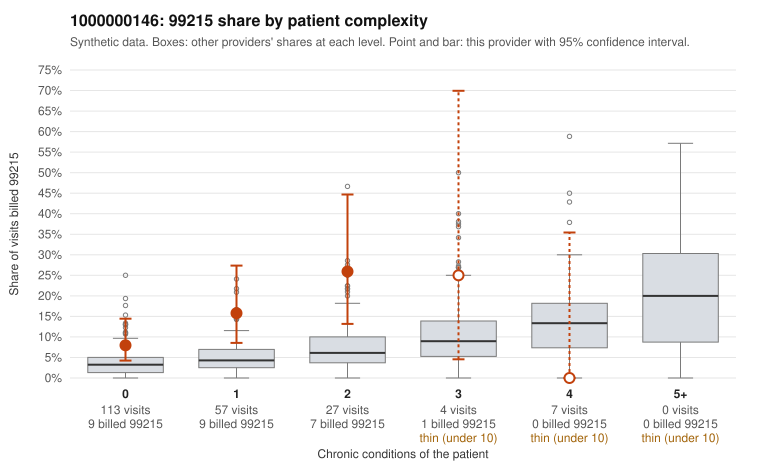

# 1000000146: 1000000146: too few returned records to judge

**Leaning (advisory):** Inconclusive

## Why

1000000146 billed 99215 on 12.5% of 208 claims against an expected 4.1% given patient complexity (risk-adjusted score 2.70; plain z-score vs peers 1.28). 69% of this provider's 99215 claims were on patients with 0 or 1 chronic conditions. Records came back for 30 claims. Of 3 documented 99215 claims, 1 (33%) were documented below the billed level, against 32% for the comparison providers. Note checks on 30 returned notes (share showing each sign): problems 47%, late 0%, unsigned 0%, data 7%. No audit trail was received. 4 of 25 notes claiming moderate-or-higher data reviewed had no lab or test line on the claim. The evidence does not support a call either way yet. Examples: C0056951: billed 99215, patient aged 60 with 0 chronic condition(s); documented MDM level moderate, 30 minutes. C0056840: billed 99215, patient aged 38 with 0 chronic condition(s). C0056874: billed 99215, patient aged 47 with 0 chronic condition(s).

## Evidence chart

## Cited claims

`C0056951`, `C0056840`, `C0056874`

## Suggested next steps

- 30 charts came back but do not settle it: request a targeted sample of 99215 charts, starting with C0056951, C0056840, C0056874.
- Re-check after the targeted charts arrive; do not call upcoding or a sicker panel on this evidence alone.

---
Citations checked: 3/3 valid. Synthetic data. The leaning is advisory; the flag comes from the statistical screen, and no clinical documentation is available beyond the sampled records-review facts shown in the packet.
