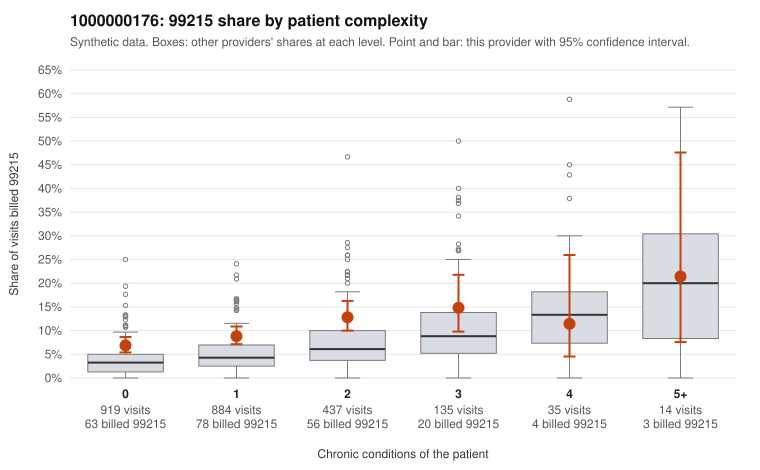

# 1000000176: 1000000176: 1 of 19 documented 99215 claims (5%) are documented below the billed level

**Leaning (advisory):** Pattern consistent with upcoding

## Why

1000000176 billed 99215 on 9.2% of 2,424 claims against an expected 4.4% given patient complexity (risk-adjusted score 5.08; plain z-score vs peers 0.58). 63% of this provider's 99215 claims were on patients with 0 or 1 chronic conditions. Records came back for 45 claims. Of 19 documented 99215 claims, 1 (5%) were documented below the billed level, against 32% for the comparison providers. Note checks on 45 returned notes (share showing each sign): problems 42%, late 22%, unsigned 0%, data 16%. No audit trail was received. 7 of 37 notes claiming moderate-or-higher data reviewed had no lab or test line on the claim. This pattern is consistent with upcoding. It is a reason to review the records, not a finding. Examples: C0072288: billed 99215; documented MDM level moderate, minutes not recorded. C0071823: billed 99215, patient aged 38 with 1 chronic condition(s) (hypothyroidism). C0071863: billed 99215, patient aged 56 with 1 chronic condition(s) (hypertension). C0072021: billed 99215, patient aged 23 with 1 chronic condition(s) (hypertension).

## Evidence chart

## Cited claims

`C0072288`, `C0071823`, `C0071863`, `C0072021`

## Suggested next steps

- Request the full charts for C0072288, C0071823, C0071863 and have a certified coder re-score each against the current E/M rules (medical decision making or total time).
- If the re-scoring confirms the pattern, review the random sample in the recovery packet's sampling plan before any overpayment estimate; do not extrapolate from a targeted sample.
- Look at the notes themselves: 42% address fewer problems than their level implies and 22% were signed late; request the audit trail for C0072288, C0071823, C0071863.

---
Citations checked: 4/4 valid. Synthetic data. The leaning is advisory; the flag comes from the statistical screen, and no clinical documentation is available beyond the sampled records-review facts shown in the packet.
