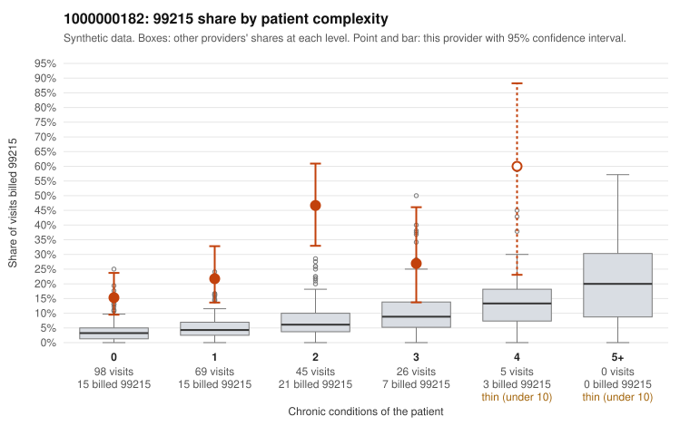

# 1000000182: Provider 1000000182 bills 99215 far above expectation, often on low-complexity patients, but every documented 99215 is supported by notes that carry integrity flags, so the result is inconclusive.

**Leaning (advisory):** Inconclusive

## Why

1000000182 billed 99215 on 25.1% of 243 claims against an expected 4.6% given patient complexity (risk-adjusted score 6.79; plain z-score vs peers 3.95). 49% of this provider's 99215 claims were on patients with 0 or 1 chronic conditions. Records came back for 43 claims. Of 17 documented 99215 claims, 0 (0%) were documented below the billed level, against 32% for the comparison providers. Note checks on 43 returned notes (share showing each sign): problems 56%, late 21%, unsigned 0%, data 21%, bulk created 7%, paste heavy 12%. 10 of 33 notes claiming moderate-or-higher data reviewed had no lab or test line on the claim. The claims pattern is concerning. The 99215 share runs well above the all-provider rate in every complexity tier, not just among multi-condition patients. The low-complexity sample includes 99215s for minor or acute diagnoses, such as upper respiratory infection (C0076070, C0076158), rash (C0076136, C0076153), follow-up exam (C0076098) and abdominal pain (C0076274, C0076277). The documentation points the other way: none of the 17 documented 99215s fell below the billed level, including low-complexity claims like C0076068, C0076120 and C0076134 recorded at high MDM. That would ordinarily favor a legitimately complex panel. Several signs weaken that reassurance. Data review is claimed on notes with no lab or test line on the claim, the duplicate-note and problem-list flag rates are high, and supported examples recur in the note flags (C0076068 for problems, late entry and data; C0076134 for paste-heavy), so the notes may be templated or inflated to match the billed level rather than reflect the visit. A reviewer should first compare the audit trail and note text for the low-complexity 99215s (start with C0076068, C0076134 and C0076076) against each other and against the claim lines to check for cloned content, and should request charts for more of the uncharted low-complexity 99215s, since only a minority of claims are documented. Examples: C0076087: billed 99213; documented MDM level straightforward, minutes not recorded. C0076068: billed 99215, patient aged 42 with 1 chronic condition(s) (type 2 diabetes); documented MDM level high, minutes not recorded. C0076070: billed 99215, patient aged 45 with 0 chronic condition(s).

## Evidence chart

## Cited claims

`C0076087`, `C0076068`, `C0076070`

## Suggested next steps

- 43 charts came back but do not settle it: request a targeted sample of 99215 charts, starting with C0076087, C0076068, C0076070.
- Re-check after the targeted charts arrive; do not call upcoding or a sicker panel on this evidence alone.

---
Citations checked: 3/3 valid. Synthetic data. The leaning is advisory; the flag comes from the statistical screen, and no clinical documentation is available beyond the sampled records-review facts shown in the packet.
