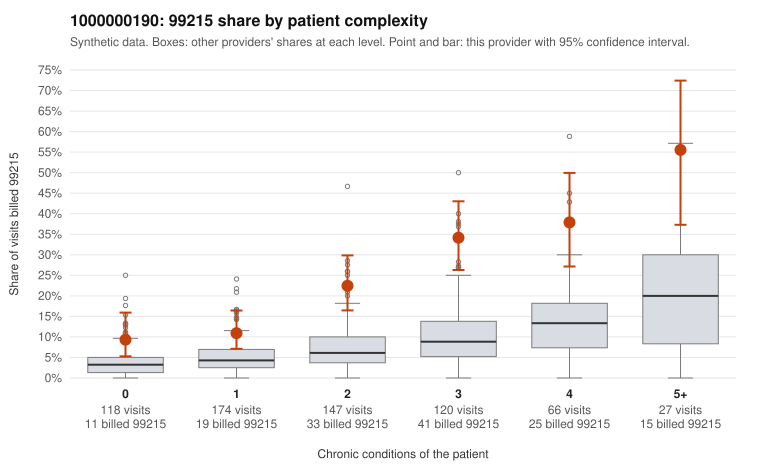

# 1000000190: 1000000190: too few returned records to judge

**Leaning (advisory):** Inconclusive

## Why

1000000190 billed 99215 on 22.1% of 652 claims against an expected 6.2% given patient complexity (risk-adjusted score 7.50; plain z-score vs peers 3.31). 21% of this provider's 99215 claims were on patients with 0 or 1 chronic conditions. Records came back for 26 claims. Of 6 documented 99215 claims, 2 (33%) were documented below the billed level, against 32% for the comparison providers. Note checks on 26 returned notes (share showing each sign): problems 15%, late 0%, unsigned 0%, data 4%. No audit trail was received. 2 of 22 notes claiming moderate-or-higher data reviewed had no lab or test line on the claim. The evidence does not support a call either way yet. Examples: C0079141: billed 99215; documented MDM level moderate, 33 minutes. C0079241: billed 99215; documented MDM level moderate, minutes not recorded. C0078848: billed 99215, patient aged 46 with 1 chronic condition(s) (osteoarthritis). C0078958: billed 99215, patient aged 60 with 0 chronic condition(s).

## Evidence chart

## Cited claims

`C0079141`, `C0079241`, `C0078848`, `C0078958`

## Suggested next steps

- 26 charts came back but do not settle it: request a targeted sample of 99215 charts, starting with C0079141, C0079241, C0078848.
- Re-check after the targeted charts arrive; do not call upcoding or a sicker panel on this evidence alone.

---
Citations checked: 4/4 valid. Synthetic data. The leaning is advisory; the flag comes from the statistical screen, and no clinical documentation is available beyond the sampled records-review facts shown in the packet.
