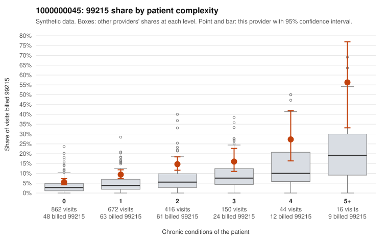

# 1000000045: 1000000045: documented 99215 claims mostly support the level billed (0% below)

**Leaning (advisory):** Pattern consistent with a high-acuity panel

## Why

1000000045 billed 99215 on 10.0% of 2,160 claims against an expected 4.0% given patient complexity (risk-adjusted score 5.88; plain z-score vs peers 0.67). 51% of this provider's 99215 claims were on patients with 0 or 1 chronic conditions. Records came back for 45 claims. Of 15 documented 99215 claims, 0 (0%) were documented below the billed level, against 35% for the comparison providers. Note checks on 45 returned notes (share showing each sign): problems 38%, late 2%, unsigned 0%, data 2%, bulk created 0%, paste heavy 0%. 2 of 33 notes claiming moderate-or-higher data reviewed had no lab or test line on the claim. This pattern is consistent with a high-acuity panel. The sampled documentation supports the billed level. Examples: C0021477: billed 99215; documented MDM level high, minutes not recorded. C0021545: billed 99215; documented MDM level high, minutes not recorded. C0021703: billed 99215; documented MDM level high, 31 minutes. C0020361: billed 99215, patient aged 65 with 5 chronic condition(s) (hypothyroidism;hyperlipidemia;hypertension;osteoarthritis;chronic kidney disease). C0020654: billed 99215, patient aged 59 with 4 chronic condition(s) (type 2 diabetes;depression;hypertension;asthma).

## Evidence chart

## Cited claims

`C0021477`, `C0021545`, `C0021703`, `C0020361`, `C0020654`

## Suggested next steps

- Do not pursue recovery on this evidence: 45 charts came back and they support the level billed (0 of 15 documented 99215 claims below the billed level).
- Revisit if the 99215 share keeps rising against peers or a larger sample shows unsupported claims.

---
Citations checked: 5/5 valid. Synthetic data. The leaning is advisory; the flag comes from the statistical screen, and no clinical documentation is available beyond the sampled records-review facts shown in the packet.
