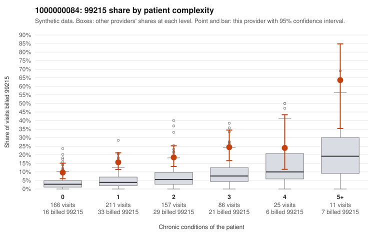

# 1000000084: 1000000084: too few returned records to judge

**Leaning (advisory):** Inconclusive

## Why

1000000084 billed 99215 on 17.1% of 656 claims against an expected 4.6% given patient complexity (risk-adjusted score 6.21; plain z-score vs peers 1.98). 44% of this provider's 99215 claims were on patients with 0 or 1 chronic conditions. Records came back for 44 claims. Of 17 documented 99215 claims, 5 (29%) were documented below the billed level, against 35% for the comparison providers. Note checks on 44 returned notes (share showing each sign): problems 25%, late 7%, unsigned 0%, data 2%. No audit trail was received. 3 of 34 notes claiming moderate-or-higher data reviewed had no lab or test line on the claim. The evidence does not support a call either way yet. Examples: C0037033: billed 99215; documented MDM level moderate, minutes not recorded. C0037069: billed 99215, patient aged 39 with 1 chronic condition(s) (hyperlipidemia); documented MDM level low, minutes not recorded. C0036986: billed 99215, patient aged 53 with 1 chronic condition(s) (hypertension). C0037010: billed 99215, patient aged 46 with 1 chronic condition(s) (osteoarthritis).

## Evidence chart

## Cited claims

`C0037033`, `C0037069`, `C0036986`, `C0037010`

## Suggested next steps

- 44 charts came back but do not settle it: request a targeted sample of 99215 charts, starting with C0037033, C0037069, C0036986.
- Re-check after the targeted charts arrive; do not call upcoding or a sicker panel on this evidence alone.

---
Citations checked: 4/4 valid. Synthetic data. The leaning is advisory; the flag comes from the statistical screen, and no clinical documentation is available beyond the sampled records-review facts shown in the packet.
