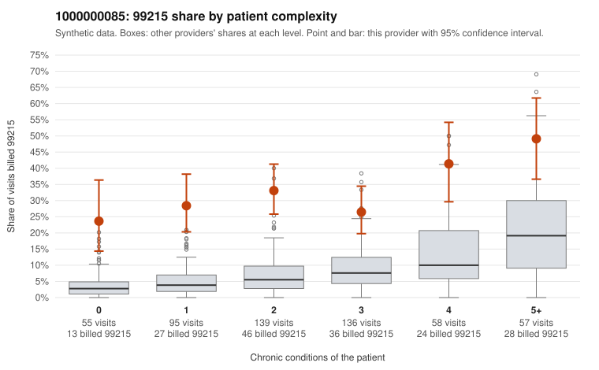

# 1000000085: 1000000085: too few returned records to judge

**Leaning (advisory):** Inconclusive

## Why

1000000085 billed 99215 on 32.2% of 540 claims against an expected 6.9% given patient complexity (risk-adjusted score 9.69; plain z-score vs peers 4.83). 23% of this provider's 99215 claims were on patients with 0 or 1 chronic conditions. Records came back for 30 claims. Of 9 documented 99215 claims, 1 (11%) were documented below the billed level, against 35% for the comparison providers. Note checks on 30 returned notes (share showing each sign): problems 23%, late 13%, unsigned 0%, data 17%. No audit trail was received. 5 of 26 notes claiming moderate-or-higher data reviewed had no lab or test line on the claim. The evidence does not support a call either way yet. Examples: C0038213: billed 99215; documented MDM level moderate, minutes not recorded. C0037708: billed 99215, patient aged 44 with 0 chronic condition(s). C0037730: billed 99215, patient aged 60 with 0 chronic condition(s).

## Evidence chart

## Cited claims

`C0038213`, `C0037708`, `C0037730`

## Suggested next steps

- 30 charts came back but do not settle it: request a targeted sample of 99215 charts, starting with C0038213, C0037708, C0037730.
- Re-check after the targeted charts arrive; do not call upcoding or a sicker panel on this evidence alone.

---
Citations checked: 3/3 valid. Synthetic data. The leaning is advisory; the flag comes from the statistical screen, and no clinical documentation is available beyond the sampled records-review facts shown in the packet.
