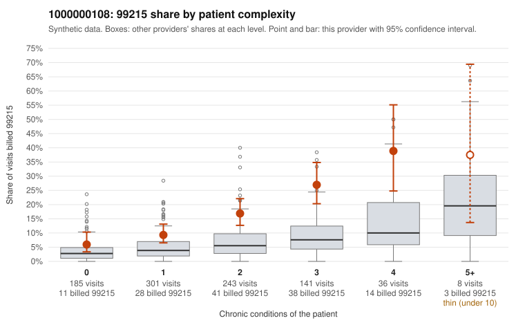

# 1000000108: 1000000108: too few returned records to judge

**Leaning (advisory):** Inconclusive

## Why

1000000108 billed 99215 on 14.8% of 914 claims against an expected 4.7% given patient complexity (risk-adjusted score 5.88; plain z-score vs peers 1.55). 29% of this provider's 99215 claims were on patients with 0 or 1 chronic conditions. Records came back for 44 claims. Of 16 documented 99215 claims, 2 (12%) were documented below the billed level, against 35% for the comparison providers. Note checks on 44 returned notes (share showing each sign): problems 14%, late 0%, unsigned 0%, data 7%. No audit trail was received. 4 of 35 notes claiming moderate-or-higher data reviewed had no lab or test line on the claim. The evidence does not support a call either way yet. Examples: C0049632: billed 99215, patient aged 47 with 0 chronic condition(s); documented MDM level moderate, minutes not recorded. C0049856: billed 99215; documented MDM level moderate, minutes not recorded. C0049359: billed 99215, patient aged 59 with 1 chronic condition(s) (obesity). C0049403: billed 99215, patient aged 45 with 0 chronic condition(s).

## Evidence chart

## Cited claims

`C0049632`, `C0049856`, `C0049359`, `C0049403`

## Suggested next steps

- 44 charts came back but do not settle it: request a targeted sample of 99215 charts, starting with C0049632, C0049856, C0049359.
- Re-check after the targeted charts arrive; do not call upcoding or a sicker panel on this evidence alone.

---
Citations checked: 4/4 valid. Synthetic data. The leaning is advisory; the flag comes from the statistical screen, and no clinical documentation is available beyond the sampled records-review facts shown in the packet.
