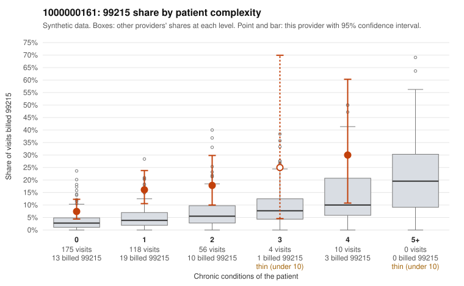

# 1000000161: 1000000161: 0 of 20 documented 99215 claims (0%) are documented below the billed level

**Leaning (advisory):** Pattern consistent with upcoding

## Why

1000000161 billed 99215 on 12.7% of 363 claims against an expected 3.6% given patient complexity (risk-adjusted score 3.73; plain z-score vs peers 1.16). 70% of this provider's 99215 claims were on patients with 0 or 1 chronic conditions. Records came back for 45 claims. Of 20 documented 99215 claims, 0 (0%) were documented below the billed level, against 35% for the comparison providers. Note checks on 45 returned notes (share showing each sign): problems 56%, late 16%, unsigned 0%, data 0%, bulk created 2%, paste heavy 4%. 1 of 36 notes claiming moderate-or-higher data reviewed had no lab or test line on the claim. This pattern is consistent with upcoding. It is a reason to review the records, not a finding. Examples: C0078141: billed 99213; documented MDM level straightforward, minutes not recorded. C0077901: billed 99215, patient aged 79 with 0 chronic condition(s); documented MDM level high, 47 minutes. C0077903: billed 99215, patient aged 43 with 1 chronic condition(s) (hypertension). C0077915: billed 99215, patient aged 69 with 1 chronic condition(s) (atrial fibrillation).

## Evidence chart

## Cited claims

`C0078141`, `C0077901`, `C0077903`, `C0077915`

## Suggested next steps

- Request the full charts for C0078141, C0077901, C0077903 and have a certified coder re-score each against the current E/M rules (medical decision making or total time).
- If the re-scoring confirms the pattern, review the random sample in the recovery packet's sampling plan before any overpayment estimate; do not extrapolate from a targeted sample.
- Look at the notes themselves: 56% address fewer problems than their level implies and 16% were signed late; request the audit trail for C0078141, C0077901, C0077903.

---
Citations checked: 4/4 valid. Synthetic data. The leaning is advisory; the flag comes from the statistical screen, and no clinical documentation is available beyond the sampled records-review facts shown in the packet.
