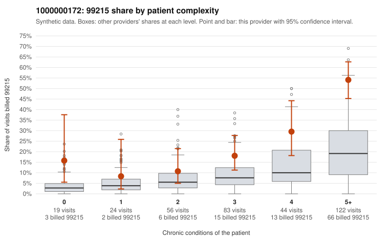

# 1000000172: 1000000172: documented 99215 claims mostly support the level billed (11% below)

**Leaning (advisory):** Pattern consistent with a high-acuity panel

## Why

1000000172 billed 99215 on 30.2% of 348 claims against an expected 10.2% given patient complexity (risk-adjusted score 5.07; plain z-score vs peers 4.44). 5% of this provider's 99215 claims were on patients with 0 or 1 chronic conditions. Records came back for 29 claims. Of 18 documented 99215 claims, 2 (11%) were documented below the billed level, against 35% for the comparison providers. Note checks on 29 returned notes (share showing each sign): problems 3%, late 3%, unsigned 0%, data 0%. No audit trail was received. 2 of 27 notes claiming moderate-or-higher data reviewed had no lab or test line on the claim. This pattern is consistent with a high-acuity panel. The sampled documentation supports the billed level. Examples: C0081426: billed 99215; documented MDM level high, 52 minutes. C0081465: billed 99215; documented MDM level high, 49 minutes. C0081599: billed 99215, patient aged 34 with 4 chronic condition(s) (hypothyroidism;hyperlipidemia;hypertension;heart failure); documented MDM level high, minutes not recorded. C0081411: billed 99215, patient aged 61 with 5 chronic condition(s) (hypothyroidism;obesity;hyperlipidemia;hypertension;osteoarthritis). C0081439: billed 99215, patient aged 96 with 5 chronic condition(s) (hypothyroidism;type 2 diabetes;hyperlipidemia;depression;asthma).

## Evidence chart

## Cited claims

`C0081426`, `C0081465`, `C0081599`, `C0081411`, `C0081439`

## Suggested next steps

- Do not pursue recovery on this evidence: 29 charts came back and they support the level billed (2 of 18 documented 99215 claims below the billed level).
- Revisit if the 99215 share keeps rising against peers or a larger sample shows unsupported claims.

---
Citations checked: 5/5 valid. Synthetic data. The leaning is advisory; the flag comes from the statistical screen, and no clinical documentation is available beyond the sampled records-review facts shown in the packet.
