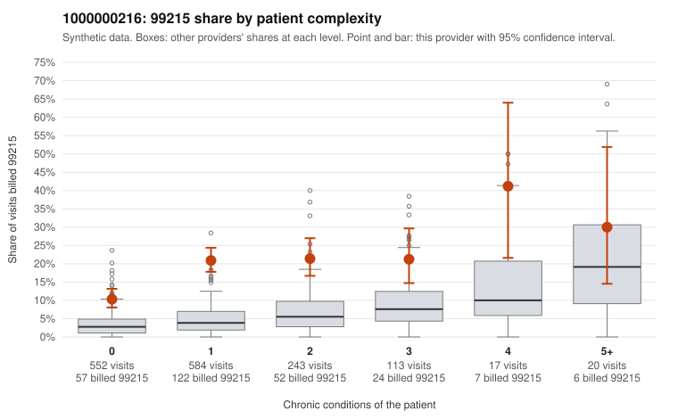

# 1000000216: Provider 1000000216's heavy 99215 billing falls mostly on low-complexity patients, but the returned charts largely support the billed level, while signs of cloned or inflated notes leave the picture unresolved.

**Leaning (advisory):** Inconclusive

## Why

1000000216 billed 99215 on 17.5% of 1,529 claims against an expected 4.0% given patient complexity (risk-adjusted score 11.14; plain z-score vs peers 2.07). 67% of this provider's 99215 claims were on patients with 0 or 1 chronic conditions. Records came back for 42 claims. Of 19 documented 99215 claims, 2 (10%) were documented below the billed level, against 35% for the comparison providers. Note checks on 42 returned notes (share showing each sign): problems 36%, late 31%, unsigned 0%, data 19%. No audit trail was received. 9 of 32 notes claiming moderate-or-higher data reviewed had no lab or test line on the claim. The billing pattern resembles upcoding: 99215 use is elevated in every complexity band, including patients with no chronic conditions, and the low-complexity sample includes visits for routine problems such as UTI, follow-up (Z09) and URI codes. Against that, the documented 99215 claims show an unsupported rate far below the comparison providers. On its own, that would point to legitimate complexity. The supporting notes may not be trustworthy, though. About a third of returned notes are flagged as duplicates, a third have problem-list flags and about a third are late. Several notes claim moderate-or-higher data review with no lab or test line on the claim, which is weak evidence of inflated documentation, not proof. Records cover only about 3% of claims and no audit trail was received, so a reviewer should first request audit trails and compare the returned 99215 notes for cloned text, starting with C0098636 (a zero-condition UTI visit documented as high MDM at 52 minutes, also flagged in note checks) and the unsupported C0100079. Examples: C0099777: billed 99215; documented MDM level moderate, minutes not recorded. C0100079: billed 99215, patient aged 31 with 1 chronic condition(s) (type 2 diabetes); documented MDM level moderate, minutes not recorded. C0098549: billed 99215, patient aged 22 with 0 chronic condition(s). C0098576: billed 99215, patient aged 58 with 0 chronic condition(s).

## Evidence chart

## Cited claims

`C0099777`, `C0100079`, `C0098549`, `C0098576`

## Suggested next steps

- 42 charts came back but do not settle it: request a targeted sample of 99215 charts, starting with C0099777, C0100079, C0098549.
- Re-check after the targeted charts arrive; do not call upcoding or a sicker panel on this evidence alone.

---
Citations checked: 4/4 valid. Synthetic data. The leaning is advisory; the flag comes from the statistical screen, and no clinical documentation is available beyond the sampled records-review facts shown in the packet.
