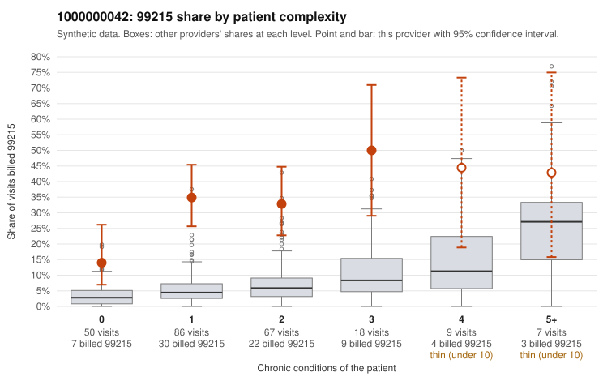

# 1000000042: Provider 1000000042 bills 99215 far above what its mostly low-complexity panel predicts, yet its small set of returned 99215 charts supports the billed level, with signs the notes may be cloned or inflated.

**Leaning (advisory):** Inconclusive

## Why

1000000042 billed 99215 on 31.6% of 237 claims against an expected 4.8% given patient complexity (risk-adjusted score 6.89; plain z-score vs peers 3.80). 49% of this provider's 99215 claims were on patients with 0 or 1 chronic conditions. Records came back for 30 claims. Of 11 documented 99215 claims, 0 (0%) were documented below the billed level, against 15% for the comparison providers. Note checks on 30 returned notes (share showing each sign): problems 30%, late 13%, unsigned 0%, data 13%. No audit trail was received. 7 of 24 notes claiming moderate-or-higher data reviewed had no lab or test line on the claim. The claims pattern is consistent with upcoding: the 99215 share is elevated in every complexity band, not just among sicker patients, and about half of 99215s fall on patients with 0–1 conditions. Sampled examples include C0027151 (Z09 follow-up, no chronic conditions) and C0027205 (J06.9 upper respiratory infection). Against that, none of the 11 documented 99215 charts fell below the billed level (for example C0027096 and C0027181 show high MDM), which would ordinarily point toward a legitimately complex panel. That is a small sample, though, and the note checks weaken it: there are problem flags (including C0027151 and C0027247), duplicate and repeated-time patterns, late notes (including the supported C0027185), and data-reviewed claims with no lab or test line on the claim. Together these are weak evidence that the documentation may have been written to match the billed level rather than the visit. A reviewer should first obtain the audit trail and pull full charts for the low-complexity 99215 claims. In those charts, compare note text across patients for cloning and check whether the claimed data review matches actual orders or results. Examples: C0027303: billed 99214; documented MDM level low, minutes not recorded. C0027088: billed 99215, patient aged 19 with 1 chronic condition(s) (asthma). C0027093: billed 99215, patient aged 58 with 1 chronic condition(s) (osteoarthritis).

## Evidence chart

## Cited claims

`C0027303`, `C0027088`, `C0027093`

## Suggested next steps

- 30 charts came back but do not settle it: request a targeted sample of 99215 charts, starting with C0027303, C0027088, C0027093.
- Re-check after the targeted charts arrive; do not call upcoding or a sicker panel on this evidence alone.

---
Citations checked: 3/3 valid. Synthetic data. The leaning is advisory; the flag comes from the statistical screen, and no clinical documentation is available beyond the sampled records-review facts shown in the packet.
