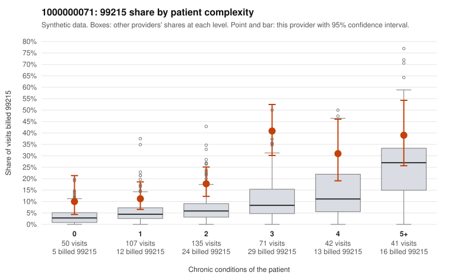

# 1000000071: 1000000071: too few returned records to judge

**Leaning (advisory):** Inconclusive

## Why

1000000071 billed 99215 on 22.2% of 446 claims against an expected 6.4% given patient complexity (risk-adjusted score 4.78; plain z-score vs peers 2.30). 17% of this provider's 99215 claims were on patients with 0 or 1 chronic conditions. Records came back for 30 claims. Of 7 documented 99215 claims, 0 (0%) were documented below the billed level, against 15% for the comparison providers. Note checks on 30 returned notes (share showing each sign): problems 10%, late 7%, unsigned 0%, data 10%. No audit trail was received. 3 of 23 notes claiming moderate-or-higher data reviewed had no lab or test line on the claim. The evidence does not support a call either way yet. Examples: C0036454: billed 99213; documented MDM level straightforward, minutes not recorded. C0036658: billed 99214; documented MDM level low, minutes not recorded. C0036494: billed 99215, patient aged 55 with 1 chronic condition(s) (COPD). C0036497: billed 99215, patient aged 29 with 1 chronic condition(s) (hypertension).

## Evidence chart

## Cited claims

`C0036454`, `C0036658`, `C0036494`, `C0036497`

## Suggested next steps

- 30 charts came back but do not settle it: request a targeted sample of 99215 charts, starting with C0036454, C0036658, C0036494.
- Re-check after the targeted charts arrive; do not call upcoding or a sicker panel on this evidence alone.

---
Citations checked: 4/4 valid. Synthetic data. The leaning is advisory; the flag comes from the statistical screen, and no clinical documentation is available beyond the sampled records-review facts shown in the packet.
