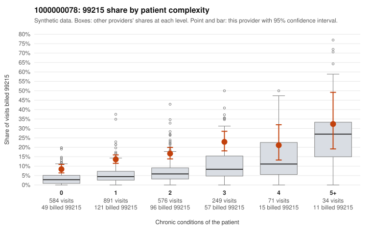

# 1000000078: 1000000078: 13 of 19 documented 99215 claims (68%) are documented below the billed level

**Leaning (advisory):** Pattern consistent with upcoding

## Why

1000000078 billed 99215 on 14.5% of 2,405 claims against an expected 4.6% given patient complexity (risk-adjusted score 8.40; plain z-score vs peers 1.08). 49% of this provider's 99215 claims were on patients with 0 or 1 chronic conditions. Records came back for 21 claims. Of 19 documented 99215 claims, 13 (68%) were documented below the billed level, against 15% for the comparison providers. Note checks on 21 returned notes (share showing each sign): problems 29%, late 5%, unsigned 0%, data 5%. No audit trail was received. 2 of 16 notes claiming moderate-or-higher data reviewed had no lab or test line on the claim. This pattern is consistent with upcoding. It is a reason to review the records, not a finding. Examples: C0038353: billed 99215, patient aged 63 with 1 chronic condition(s) (type 2 diabetes); documented MDM level moderate, minutes not recorded. C0039416: billed 99215; documented MDM level moderate, 32 minutes. C0039473: billed 99215; documented MDM level moderate, minutes not recorded. C0038312: billed 99215, patient aged 53 with 0 chronic condition(s). C0038832: billed 99215, patient aged 47 with 1 chronic condition(s) (obesity).

## Evidence chart

## Cited claims

`C0038353`, `C0039416`, `C0039473`, `C0038312`, `C0038832`

## Suggested next steps

- Request the full charts for C0038353, C0039416, C0039473 and have a certified coder re-score each against the current E/M rules (medical decision making or total time).
- If the re-scoring confirms the pattern, review the random sample in the recovery packet's sampling plan before any overpayment estimate; do not extrapolate from a targeted sample.
- Look at the notes themselves: 29% address fewer problems than their level implies and 5% were signed late; request the audit trail for C0038353, C0039416, C0039473.

---
Citations checked: 5/5 valid. Synthetic data. The leaning is advisory; the flag comes from the statistical screen, and no clinical documentation is available beyond the sampled records-review facts shown in the packet.
