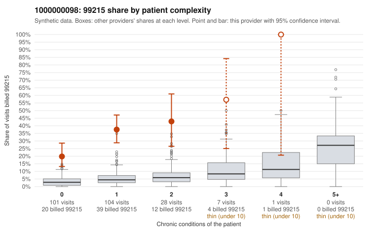

# 1000000098: 1000000098: 8 of 10 documented 99215 claims (80%) are documented below the billed level

**Leaning (advisory):** Pattern consistent with upcoding

## Why

1000000098 billed 99215 on 31.5% of 241 claims against an expected 3.6% given patient complexity (risk-adjusted score 8.31; plain z-score vs peers 3.78). 78% of this provider's 99215 claims were on patients with 0 or 1 chronic conditions. Records came back for 30 claims. Of 10 documented 99215 claims, 8 (80%) were documented below the billed level, against 15% for the comparison providers. Note checks on 30 returned notes (share showing each sign): problems 37%, late 3%, unsigned 0%, data 3%, bulk created 0%, paste heavy 0%. 1 of 19 notes claiming moderate-or-higher data reviewed had no lab or test line on the claim. This pattern is consistent with upcoding. It is a reason to review the records, not a finding. Examples: C0048309: billed 99215; documented MDM level moderate, 34 minutes. C0048316: billed 99215, patient aged 61 with 1 chronic condition(s) (hypertension); documented MDM level moderate, 37 minutes. C0048378: billed 99215; documented MDM level moderate, 38 minutes. C0048273: billed 99215, patient aged 46 with 0 chronic condition(s). C0048284: billed 99215, patient aged 20 with 0 chronic condition(s). C0048291: billed 99215, patient aged 39 with 0 chronic condition(s).

## Evidence chart

## Cited claims

`C0048309`, `C0048316`, `C0048378`, `C0048273`, `C0048284`, `C0048291`

## Suggested next steps

- Request the full charts for C0048309, C0048316, C0048378 and have a certified coder re-score each against the current E/M rules (medical decision making or total time).
- If the re-scoring confirms the pattern, review the random sample in the recovery packet's sampling plan before any overpayment estimate; do not extrapolate from a targeted sample.
- Look at the notes themselves: 37% address fewer problems than their level implies and 3% were signed late; request the audit trail for C0048309, C0048316, C0048378.

---
Citations checked: 6/6 valid. Synthetic data. The leaning is advisory; the flag comes from the statistical screen, and no clinical documentation is available beyond the sampled records-review facts shown in the packet.
