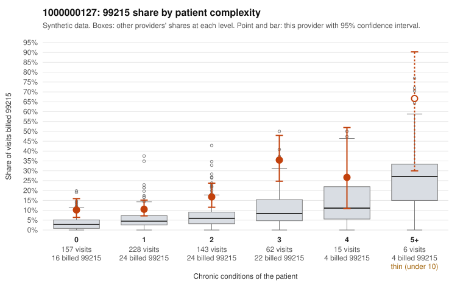

# 1000000127: 1000000127: too few returned records to judge

**Leaning (advisory):** Inconclusive

## Why

1000000127 billed 99215 on 15.4% of 611 claims against an expected 4.4% given patient complexity (risk-adjusted score 4.59; plain z-score vs peers 1.21). 43% of this provider's 99215 claims were on patients with 0 or 1 chronic conditions. Records came back for 30 claims. Of 7 documented 99215 claims, 1 (14%) were documented below the billed level, against 15% for the comparison providers. Note checks on 30 returned notes (share showing each sign): problems 23%, late 0%, unsigned 0%, data 0%. No audit trail was received. 1 of 23 notes claiming moderate-or-higher data reviewed had no lab or test line on the claim. The evidence does not support a call either way yet. Examples: C0063458: billed 99215; documented MDM level moderate, minutes not recorded. C0063246: billed 99215, patient aged 38 with 1 chronic condition(s) (chronic kidney disease). C0063254: billed 99215, patient aged 60 with 1 chronic condition(s) (obesity).

## Evidence chart

## Cited claims

`C0063458`, `C0063246`, `C0063254`

## Suggested next steps

- 30 charts came back but do not settle it: request a targeted sample of 99215 charts, starting with C0063458, C0063246, C0063254.
- Re-check after the targeted charts arrive; do not call upcoding or a sicker panel on this evidence alone.

---
Citations checked: 3/3 valid. Synthetic data. The leaning is advisory; the flag comes from the statistical screen, and no clinical documentation is available beyond the sampled records-review facts shown in the packet.
