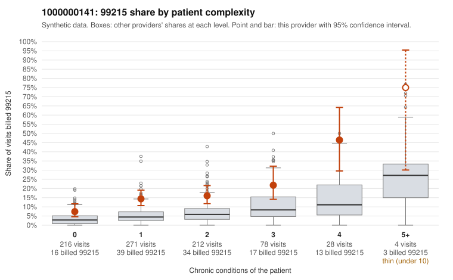

# 1000000141: 1000000141: too few returned records to judge

**Leaning (advisory):** Inconclusive

## Why

1000000141 billed 99215 on 15.1% of 809 claims against an expected 4.4% given patient complexity (risk-adjusted score 5.16; plain z-score vs peers 1.17). 45% of this provider's 99215 claims were on patients with 0 or 1 chronic conditions. Records came back for 44 claims. Of 17 documented 99215 claims, 2 (12%) were documented below the billed level, against 15% for the comparison providers. Note checks on 44 returned notes (share showing each sign): problems 32%, late 4%, unsigned 0%, data 4%. No audit trail was received. 3 of 31 notes claiming moderate-or-higher data reviewed had no lab or test line on the claim. The evidence does not support a call either way yet. Examples: C0072793: billed 99215, patient aged 24 with 1 chronic condition(s) (hyperlipidemia); documented MDM level moderate, minutes not recorded. C0073269: billed 99215; documented MDM level moderate, minutes not recorded. C0072790: billed 99215, patient aged 55 with 1 chronic condition(s) (hypertension).

## Evidence chart

## Cited claims

`C0072793`, `C0073269`, `C0072790`

## Suggested next steps

- 44 charts came back but do not settle it: request a targeted sample of 99215 charts, starting with C0072793, C0073269, C0072790.
- Re-check after the targeted charts arrive; do not call upcoding or a sicker panel on this evidence alone.

---
Citations checked: 3/3 valid. Synthetic data. The leaning is advisory; the flag comes from the statistical screen, and no clinical documentation is available beyond the sampled records-review facts shown in the packet.
