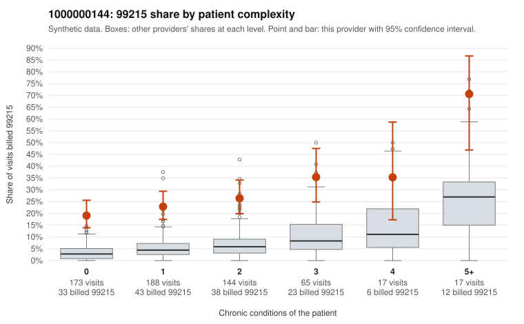

# 1000000144: 1000000144: 16 of 24 documented 99215 claims (67%) are documented below the billed level

**Leaning (advisory):** Pattern consistent with upcoding

## Why

1000000144 billed 99215 on 25.7% of 604 claims against an expected 4.7% given patient complexity (risk-adjusted score 8.76; plain z-score vs peers 2.85). 49% of this provider's 99215 claims were on patients with 0 or 1 chronic conditions. Records came back for 44 claims. Of 24 documented 99215 claims, 16 (67%) were documented below the billed level, against 15% for the comparison providers. Note checks on 44 returned notes (share showing each sign): problems 16%, late 4%, unsigned 0%, data 4%. No audit trail was received. 4 of 33 notes claiming moderate-or-higher data reviewed had no lab or test line on the claim. This pattern is consistent with upcoding. It is a reason to review the records, not a finding. Examples: C0077929: billed 99215; documented MDM level moderate, minutes not recorded. C0078008: billed 99215, patient aged 73 with 4 chronic condition(s) (hypothyroidism;depression;atrial fibrillation;asthma); documented MDM level moderate, minutes not recorded. C0078279: billed 99215; documented MDM level low, minutes not recorded. C0077794: billed 99215, patient aged 65 with 1 chronic condition(s) (type 2 diabetes). C0077828: billed 99215, patient aged 73 with 1 chronic condition(s) (chronic kidney disease). C0077854: billed 99215, patient aged 30 with 0 chronic condition(s).

## Evidence chart

## Cited claims

`C0077929`, `C0078008`, `C0078279`, `C0077794`, `C0077828`, `C0077854`

## Suggested next steps

- Request the full charts for C0077929, C0078008, C0078279 and have a certified coder re-score each against the current E/M rules (medical decision making or total time).
- If the re-scoring confirms the pattern, review the random sample in the recovery packet's sampling plan before any overpayment estimate; do not extrapolate from a targeted sample.
- Look at the notes themselves: 16% address fewer problems than their level implies and 4% were signed late; request the audit trail for C0077929, C0078008, C0078279.

---
Citations checked: 6/6 valid. Synthetic data. The leaning is advisory; the flag comes from the statistical screen, and no clinical documentation is available beyond the sampled records-review facts shown in the packet.
