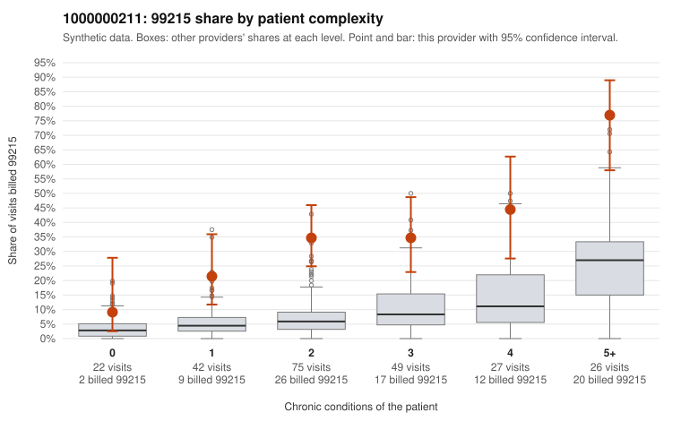

# 1000000211: 1000000211: too few returned records to judge

**Leaning (advisory):** Inconclusive

## Why

1000000211 billed 99215 on 35.7% of 241 claims against an expected 7.0% given patient complexity (risk-adjusted score 6.27; plain z-score vs peers 4.44). 13% of this provider's 99215 claims were on patients with 0 or 1 chronic conditions. Records came back for 30 claims. Of 11 documented 99215 claims, 0 (0%) were documented below the billed level, against 15% for the comparison providers. Note checks on 30 returned notes (share showing each sign): problems 10%, late 7%, unsigned 0%, data 3%. No audit trail was received. 2 of 21 notes claiming moderate-or-higher data reviewed had no lab or test line on the claim. The evidence does not support a call either way yet. Examples: C0106555: billed 99214; documented MDM level low, minutes not recorded. C0106470: billed 99215, patient aged 29 with 1 chronic condition(s) (hyperlipidemia). C0106484: billed 99215, patient aged 30 with 1 chronic condition(s) (atrial fibrillation).

## Evidence chart

## Cited claims

`C0106555`, `C0106470`, `C0106484`

## Suggested next steps

- 30 charts came back but do not settle it: request a targeted sample of 99215 charts, starting with C0106555, C0106470, C0106484.
- Re-check after the targeted charts arrive; do not call upcoding or a sicker panel on this evidence alone.

---
Citations checked: 3/3 valid. Synthetic data. The leaning is advisory; the flag comes from the statistical screen, and no clinical documentation is available beyond the sampled records-review facts shown in the packet.
