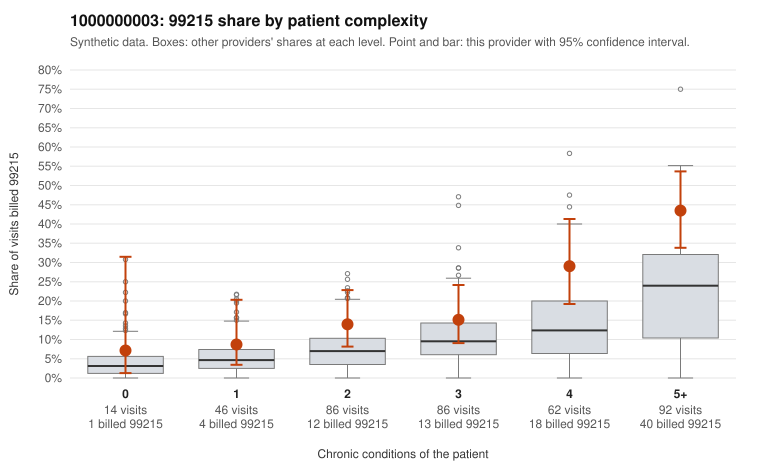

# 1000000003: 1000000003: too few returned records to judge

**Leaning (advisory):** Inconclusive

## Why

1000000003 billed 99215 on 22.8% of 386 claims against an expected 10.6% given patient complexity (risk-adjusted score 2.60; plain z-score vs peers 3.15). 6% of this provider's 99215 claims were on patients with 0 or 1 chronic conditions. Records came back for 0 claims. No documented 99215 claims came back. The evidence does not support a call either way yet. Examples: C0000427: billed 99215, patient aged 50 with 1 chronic condition(s) (hyperlipidemia). C0000454: billed 99215, patient aged 34 with 1 chronic condition(s) (hypertension).

## Evidence chart

## Cited claims

`C0000427`, `C0000454`

## Suggested next steps

- No usable charts yet: request a random sample of 30 charts, then a targeted sample of 99215s for C0000427, C0000454.
- If the practice does not respond, record that non-response is not evidence of upcoding and decide whether the claims signal alone warrants more.

---
Citations checked: 2/2 valid. Synthetic data. The leaning is advisory; the flag comes from the statistical screen, and no clinical documentation is available beyond the sampled records-review facts shown in the packet.
