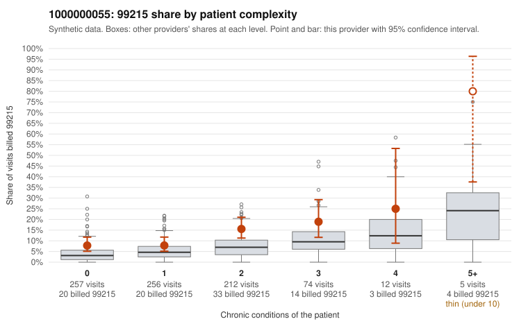

# 1000000055: 1000000055: documented 99215 claims mostly support the level billed (22% below)

**Leaning (advisory):** Pattern consistent with a high-acuity panel

## Why

1000000055 billed 99215 on 11.5% of 816 claims against an expected 5.0% given patient complexity (risk-adjusted score 2.86; plain z-score vs peers 0.89). 43% of this provider's 99215 claims were on patients with 0 or 1 chronic conditions. Records came back for 45 claims. Of 18 documented 99215 claims, 4 (22%) were documented below the billed level, against 27% for the comparison providers. Note checks on 45 returned notes (share showing each sign): problems 27%, late 7%, unsigned 0%, data 11%. No audit trail was received. 5 of 33 notes claiming moderate-or-higher data reviewed had no lab or test line on the claim. This pattern is consistent with a high-acuity panel. The sampled documentation supports the billed level. Examples: C0030639: billed 99215, patient aged 51 with 5 chronic condition(s) (hypothyroidism;type 2 diabetes;hyperlipidemia;hypertension;COPD); documented MDM level high, minutes not recorded. C0030868: billed 99215; documented MDM level high, 41 minutes. C0030959: billed 99215; documented MDM level high, 48 minutes. C0030627: billed 99215, patient aged 71 with 5 chronic condition(s) (type 2 diabetes;hyperlipidemia;depression;hypertension;chronic kidney disease).

## Evidence chart

## Cited claims

`C0030639`, `C0030868`, `C0030959`, `C0030627`

## Suggested next steps

- Do not pursue recovery on this evidence: 45 charts came back and they support the level billed (4 of 18 documented 99215 claims below the billed level).
- Revisit if the 99215 share keeps rising against peers or a larger sample shows unsupported claims.

---
Citations checked: 4/4 valid. Synthetic data. The leaning is advisory; the flag comes from the statistical screen, and no clinical documentation is available beyond the sampled records-review facts shown in the packet.
