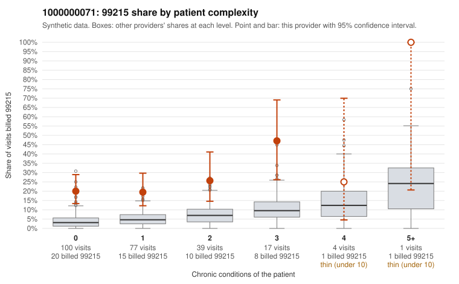

# 1000000071: 1000000071: too few returned records to judge

**Leaning (advisory):** Inconclusive

## Why

1000000071 billed 99215 on 23.1% of 238 claims against an expected 4.5% given patient complexity (risk-adjusted score 4.65; plain z-score vs peers 3.21). 64% of this provider's 99215 claims were on patients with 0 or 1 chronic conditions. Records came back for 28 claims. Of 6 documented 99215 claims, 0 (0%) were documented below the billed level, against 27% for the comparison providers. Note checks on 28 returned notes (share showing each sign): problems 46%, late 11%, unsigned 0%, data 39%, bulk created 18%, paste heavy 18%. 11 of 21 notes claiming moderate-or-higher data reviewed had no lab or test line on the claim. The evidence does not support a call either way yet. Examples: C0041403: billed 99213; documented MDM level straightforward, 12 minutes. C0041335: billed 99215, patient aged 62 with 0 chronic condition(s). C0041352: billed 99215, patient aged 60 with 0 chronic condition(s); documented MDM level high, minutes not recorded.

## Evidence chart

## Cited claims

`C0041403`, `C0041335`, `C0041352`

## Suggested next steps

- 28 charts came back but do not settle it: request a targeted sample of 99215 charts, starting with C0041403, C0041335, C0041352.
- Re-check after the targeted charts arrive; do not call upcoding or a sicker panel on this evidence alone.

---
Citations checked: 3/3 valid. Synthetic data. The leaning is advisory; the flag comes from the statistical screen, and no clinical documentation is available beyond the sampled records-review facts shown in the packet.
