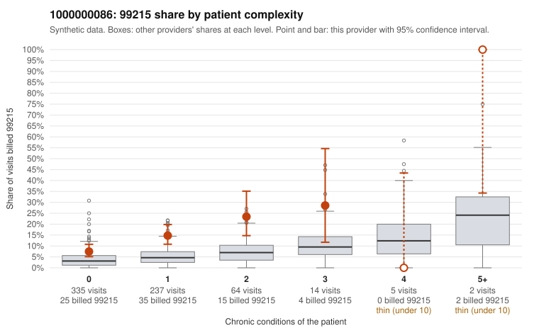

# 1000000086: 1000000086: too few returned records to judge

**Leaning (advisory):** Inconclusive

## Why

1000000086 billed 99215 on 12.3% of 657 claims against an expected 3.9% given patient complexity (risk-adjusted score 3.69; plain z-score vs peers 1.05). 74% of this provider's 99215 claims were on patients with 0 or 1 chronic conditions. Records came back for 30 claims. Of 7 documented 99215 claims, 1 (14%) were documented below the billed level, against 27% for the comparison providers. Note checks on 30 returned notes (share showing each sign): problems 53%, late 0%, unsigned 0%, data 7%, bulk created 0%, paste heavy 0%. 2 of 23 notes claiming moderate-or-higher data reviewed had no lab or test line on the claim. The evidence does not support a call either way yet. Examples: C0048855: billed 99215, patient aged 29 with 0 chronic condition(s); documented MDM level moderate, 38 minutes. C0048535: billed 99215, patient aged 47 with 0 chronic condition(s). C0048540: billed 99215, patient aged 31 with 1 chronic condition(s) (heart failure).

## Evidence chart

## Cited claims

`C0048855`, `C0048535`, `C0048540`

## Suggested next steps

- 30 charts came back but do not settle it: request a targeted sample of 99215 charts, starting with C0048855, C0048535, C0048540.
- Re-check after the targeted charts arrive; do not call upcoding or a sicker panel on this evidence alone.

---
Citations checked: 3/3 valid. Synthetic data. The leaning is advisory; the flag comes from the statistical screen, and no clinical documentation is available beyond the sampled records-review facts shown in the packet.
