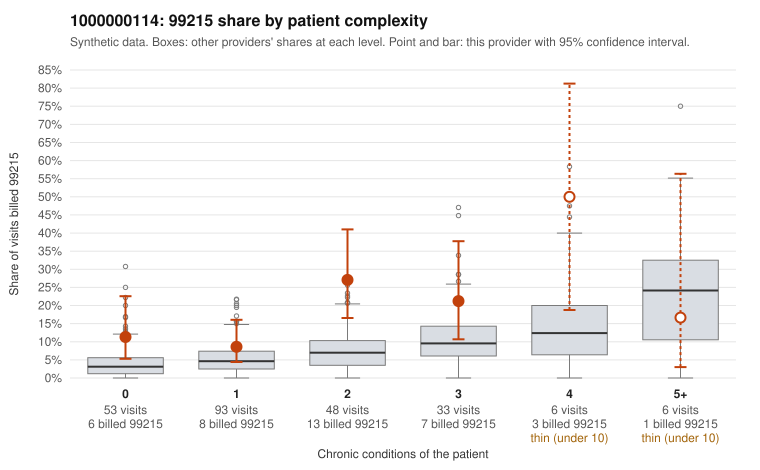

# 1000000114: 1000000114: documented 99215 claims mostly support the level billed (0% below)

**Leaning (advisory):** Pattern consistent with a high-acuity panel

## Why

1000000114 billed 99215 on 15.9% of 239 claims against an expected 5.5% given patient complexity (risk-adjusted score 2.32; plain z-score vs peers 1.77). 37% of this provider's 99215 claims were on patients with 0 or 1 chronic conditions. Records came back for 30 claims. Of 6 documented 99215 claims, 0 (0%) were documented below the billed level, against 27% for the comparison providers. Note checks on 30 returned notes (share showing each sign): problems 23%, late 13%, unsigned 0%, data 3%. No audit trail was received. 2 of 17 notes claiming moderate-or-higher data reviewed had no lab or test line on the claim. This pattern is consistent with a high-acuity panel. The sampled documentation supports the billed level. Examples: C0063577: billed 99215; documented MDM level high, 43 minutes. C0063608: billed 99215; documented MDM level high, 42 minutes. C0063657: billed 99215, patient aged 41 with 0 chronic condition(s); documented MDM level high, 43 minutes. C0063507: billed 99215, patient aged 65 with 5 chronic condition(s) (type 2 diabetes;obesity;depression;hypertension;asthma). C0063536: billed 99215, patient aged 64 with 4 chronic condition(s) (obesity;hypertension;COPD;chronic kidney disease).

## Evidence chart

## Cited claims

`C0063577`, `C0063608`, `C0063657`, `C0063507`, `C0063536`

## Suggested next steps

- Do not pursue recovery on this evidence: 30 charts came back and they support the level billed (0 of 6 documented 99215 claims below the billed level).
- Revisit if the 99215 share keeps rising against peers or a larger sample shows unsupported claims.

---
Citations checked: 5/5 valid. Synthetic data. The leaning is advisory; the flag comes from the statistical screen, and no clinical documentation is available beyond the sampled records-review facts shown in the packet.
