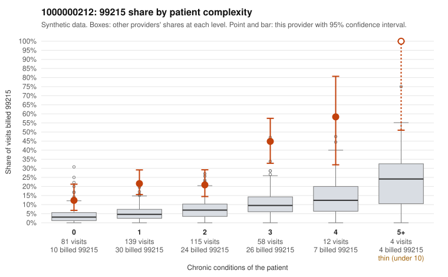

# 1000000212: 1000000212: too few returned records to judge

**Leaning (advisory):** Inconclusive

## Why

1000000212 billed 99215 on 24.7% of 409 claims against an expected 5.5% given patient complexity (risk-adjusted score 5.71; plain z-score vs peers 3.53). 40% of this provider's 99215 claims were on patients with 0 or 1 chronic conditions. Records came back for 45 claims. Of 19 documented 99215 claims, 2 (10%) were documented below the billed level, against 27% for the comparison providers. Note checks on 45 returned notes (share showing each sign): problems 18%, late 2%, unsigned 0%, data 7%. No audit trail was received. 3 of 33 notes claiming moderate-or-higher data reviewed had no lab or test line on the claim. The evidence does not support a call either way yet. Examples: C0108875: billed 99215, patient aged 41 with 1 chronic condition(s) (hypertension); documented MDM level moderate, minutes not recorded. C0109019: billed 99215, patient aged 43 with 1 chronic condition(s) (obesity); documented MDM level moderate, 32 minutes. C0108727: billed 99215, patient aged 60 with 0 chronic condition(s). C0108729: billed 99215, patient aged 54 with 0 chronic condition(s).

## Evidence chart

## Cited claims

`C0108875`, `C0109019`, `C0108727`, `C0108729`

## Suggested next steps

- 45 charts came back but do not settle it: request a targeted sample of 99215 charts, starting with C0108875, C0109019, C0108727.
- Re-check after the targeted charts arrive; do not call upcoding or a sicker panel on this evidence alone.

---
Citations checked: 4/4 valid. Synthetic data. The leaning is advisory; the flag comes from the statistical screen, and no clinical documentation is available beyond the sampled records-review facts shown in the packet.
