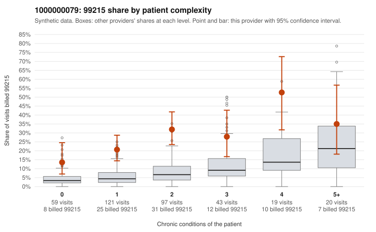

# 1000000079: 1000000079: too few returned records to judge

**Leaning (advisory):** Inconclusive

## Why

1000000079 billed 99215 on 25.9% of 359 claims against an expected 6.0% given patient complexity (risk-adjusted score 5.85; plain z-score vs peers 3.05). 35% of this provider's 99215 claims were on patients with 0 or 1 chronic conditions. Records came back for 30 claims. Of 7 documented 99215 claims, 2 (29%) were documented below the billed level, against 20% for the comparison providers. Note checks on 30 returned notes (share showing each sign): problems 20%, late 7%, unsigned 0%, data 3%. No audit trail was received. 2 of 24 notes claiming moderate-or-higher data reviewed had no lab or test line on the claim. The evidence does not support a call either way yet. Examples: C0045011: billed 99215, patient aged 53 with 1 chronic condition(s) (hyperlipidemia); documented MDM level moderate, minutes not recorded. C0045177: billed 99215, patient aged 59 with 0 chronic condition(s); documented MDM level moderate, minutes not recorded. C0045000: billed 99215, patient aged 20 with 1 chronic condition(s) (obesity). C0045001: billed 99215, patient aged 28 with 0 chronic condition(s).

## Evidence chart

## Cited claims

`C0045011`, `C0045177`, `C0045000`, `C0045001`

## Suggested next steps

- 30 charts came back but do not settle it: request a targeted sample of 99215 charts, starting with C0045011, C0045177, C0045000.
- Re-check after the targeted charts arrive; do not call upcoding or a sicker panel on this evidence alone.

---
Citations checked: 4/4 valid. Synthetic data. The leaning is advisory; the flag comes from the statistical screen, and no clinical documentation is available beyond the sampled records-review facts shown in the packet.
