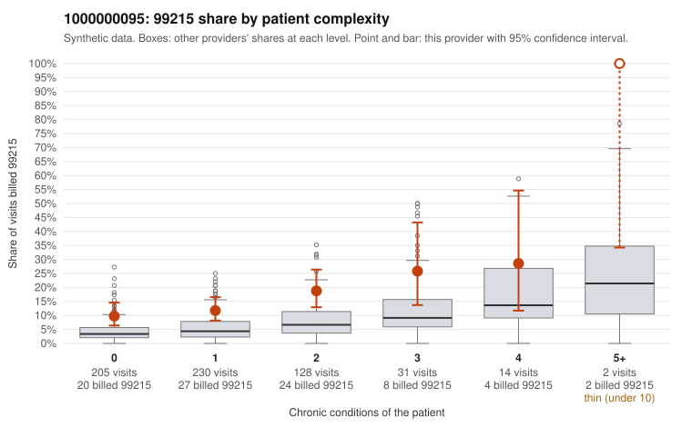

# 1000000095: 1000000095: too few returned records to judge

**Leaning (advisory):** Inconclusive

## Why

1000000095 billed 99215 on 13.9% of 610 claims against an expected 4.4% given patient complexity (risk-adjusted score 4.10; plain z-score vs peers 1.05). 55% of this provider's 99215 claims were on patients with 0 or 1 chronic conditions. Records came back for 45 claims. Of 20 documented 99215 claims, 3 (15%) were documented below the billed level, against 20% for the comparison providers. Note checks on 45 returned notes (share showing each sign): problems 27%, late 7%, unsigned 0%, data 4%. No audit trail was received. 4 of 30 notes claiming moderate-or-higher data reviewed had no lab or test line on the claim. The evidence does not support a call either way yet. Examples: C0049829: billed 99215; documented MDM level moderate, 32 minutes. C0050019: billed 99215, patient aged 19 with 0 chronic condition(s); documented MDM level moderate, 23 minutes. C0049804: billed 99215, patient aged 35 with 0 chronic condition(s). C0049809: billed 99215, patient aged 55 with 1 chronic condition(s) (type 2 diabetes).

## Evidence chart

## Cited claims

`C0049829`, `C0050019`, `C0049804`, `C0049809`

## Suggested next steps

- 45 charts came back but do not settle it: request a targeted sample of 99215 charts, starting with C0049829, C0050019, C0049804.
- Re-check after the targeted charts arrive; do not call upcoding or a sicker panel on this evidence alone.

---
Citations checked: 4/4 valid. Synthetic data. The leaning is advisory; the flag comes from the statistical screen, and no clinical documentation is available beyond the sampled records-review facts shown in the packet.
