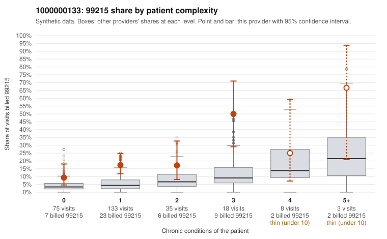

# 1000000133: 1000000133: too few returned records to judge

**Leaning (advisory):** Inconclusive

## Why

1000000133 billed 99215 on 18.0% of 272 claims against an expected 4.6% given patient complexity (risk-adjusted score 3.83; plain z-score vs peers 1.73). 61% of this provider's 99215 claims were on patients with 0 or 1 chronic conditions. Records came back for 45 claims. Of 20 documented 99215 claims, 2 (10%) were documented below the billed level, against 20% for the comparison providers. Note checks on 45 returned notes (share showing each sign): problems 16%, late 2%, unsigned 0%, data 4%. No audit trail was received. 2 of 33 notes claiming moderate-or-higher data reviewed had no lab or test line on the claim. The evidence does not support a call either way yet. Examples: C0063934: billed 99215, patient aged 51 with 1 chronic condition(s) (atrial fibrillation); documented MDM level moderate, minutes not recorded. C0063958: billed 99215, patient aged 90 with 4 chronic condition(s) (obesity;depression;hypertension;osteoarthritis); documented MDM level moderate, 30 minutes. C0063686: billed 99215, patient aged 72 with 1 chronic condition(s) (type 2 diabetes). C0063691: billed 99215, patient aged 58 with 0 chronic condition(s).

## Evidence chart

## Cited claims

`C0063934`, `C0063958`, `C0063686`, `C0063691`

## Suggested next steps

- 45 charts came back but do not settle it: request a targeted sample of 99215 charts, starting with C0063934, C0063958, C0063686.
- Re-check after the targeted charts arrive; do not call upcoding or a sicker panel on this evidence alone.

---
Citations checked: 4/4 valid. Synthetic data. The leaning is advisory; the flag comes from the statistical screen, and no clinical documentation is available beyond the sampled records-review facts shown in the packet.
