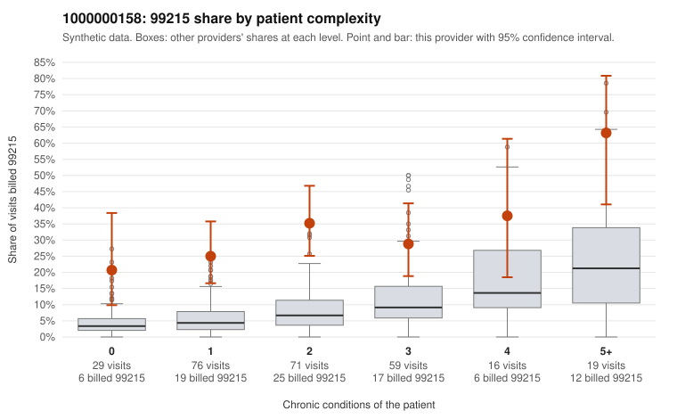

# 1000000158: Provider 1000000158 bills 99215 far above expectation in every complexity band, including patients with no chronic conditions, but the six documented 99215 charts all support the billed level and may themselves be inflated.

**Leaning (advisory):** Inconclusive

## Why

1000000158 billed 99215 on 31.5% of 270 claims against an expected 6.7% given patient complexity (risk-adjusted score 6.01; plain z-score vs peers 3.98). 29% of this provider's 99215 claims were on patients with 0 or 1 chronic conditions. Records came back for 30 claims. Of 6 documented 99215 claims, 0 (0%) were documented below the billed level, against 20% for the comparison providers. Note checks on 30 returned notes (share showing each sign): problems 30%, late 13%, unsigned 0%, data 30%. No audit trail was received. 9 of 17 notes claiming moderate-or-higher data reviewed had no lab or test line on the claim. The billing pattern does not look like a sicker panel: the 99215 share is several times the all-provider rate even for patients with 0 or 1 conditions, and sampled low-complexity claims show single routine diagnoses such as back pain (C0077103, C0077124), hypertension (C0077018) and hyperlipidemia (C0077073). On the other side, none of the six documented 99215 claims fell below the billed level, but six charts is too few to clear the provider. Those notes also deserve scrutiny. C0077103 is a 0-condition back-pain visit documented as high MDM at 54 minutes, about a quarter of returned notes show duplicate signals, and over half of the notes claiming moderate-or-higher data reviewed have no lab or test line on the claim. These are weak signs that documentation may be cloned or written to match the billed level, not proof. A reviewer should first request a larger, targeted set of charts for low-complexity 99215 claims along with the EHR audit trail, then check whether the supported notes (C0076991, C0077103, C0077077, C0077140) contain patient-specific content or templated text. Examples: C0076967: billed 99214; documented MDM level low, minutes not recorded. C0076959: billed 99215, patient aged 34 with 1 chronic condition(s) (hyperlipidemia). C0076964: billed 99215, patient aged 73 with 1 chronic condition(s) (COPD).

## Evidence chart

## Cited claims

`C0076967`, `C0076959`, `C0076964`

## Suggested next steps

- 30 charts came back but do not settle it: request a targeted sample of 99215 charts, starting with C0076967, C0076959, C0076964.
- Re-check after the targeted charts arrive; do not call upcoding or a sicker panel on this evidence alone.

---
Citations checked: 3/3 valid. Synthetic data. The leaning is advisory; the flag comes from the statistical screen, and no clinical documentation is available beyond the sampled records-review facts shown in the packet.
