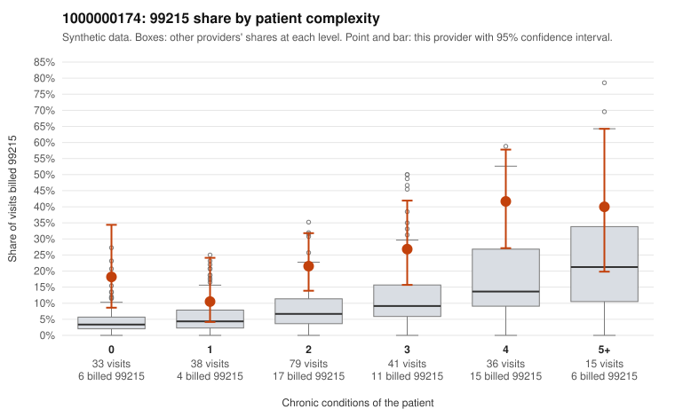

# 1000000174: 1000000174: 17 of 20 documented 99215 claims (85%) are documented below the billed level

**Leaning (advisory):** Pattern consistent with upcoding

## Why

1000000174 billed 99215 on 24.4% of 242 claims against an expected 7.1% given patient complexity (risk-adjusted score 3.79; plain z-score vs peers 2.79). 17% of this provider's 99215 claims were on patients with 0 or 1 chronic conditions. Records came back for 45 claims. Of 20 documented 99215 claims, 17 (85%) were documented below the billed level, against 20% for the comparison providers. Note checks on 45 returned notes (share showing each sign): problems 9%, late 4%, unsigned 0%, data 4%. No audit trail was received. 2 of 36 notes claiming moderate-or-higher data reviewed had no lab or test line on the claim. This pattern is consistent with upcoding. It is a reason to review the records, not a finding. Examples: C0084371: billed 99215; documented MDM level moderate, 33 minutes. C0084386: billed 99215, patient aged 48 with 1 chronic condition(s) (atrial fibrillation); documented MDM level moderate, minutes not recorded. C0084406: billed 99215, patient aged 68 with 0 chronic condition(s); documented MDM level moderate, minutes not recorded. C0084328: billed 99215, patient aged 31 with 1 chronic condition(s) (type 2 diabetes). C0084336: billed 99215, patient aged 18 with 0 chronic condition(s).

## Evidence chart

## Cited claims

`C0084371`, `C0084386`, `C0084406`, `C0084328`, `C0084336`

## Suggested next steps

- Request the full charts for C0084371, C0084386, C0084406 and have a certified coder re-score each against the current E/M rules (medical decision making or total time).
- If the re-scoring confirms the pattern, review the random sample in the recovery packet's sampling plan before any overpayment estimate; do not extrapolate from a targeted sample.
- Look at the notes themselves: 9% address fewer problems than their level implies and 4% were signed late; request the audit trail for C0084371, C0084386, C0084406.

---
Citations checked: 5/5 valid. Synthetic data. The leaning is advisory; the flag comes from the statistical screen, and no clinical documentation is available beyond the sampled records-review facts shown in the packet.
