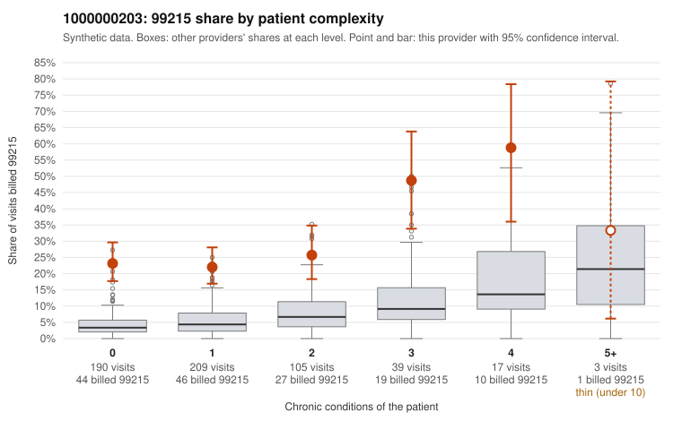

# 1000000203: 1000000203: 5 of 9 documented 99215 claims (56%) are documented below the billed level

**Leaning (advisory):** Pattern consistent with upcoding

## Why

1000000203 billed 99215 on 26.1% of 563 claims against an expected 4.5% given patient complexity (risk-adjusted score 9.07; plain z-score vs peers 3.08). 61% of this provider's 99215 claims were on patients with 0 or 1 chronic conditions. Records came back for 30 claims. Of 9 documented 99215 claims, 5 (56%) were documented below the billed level, against 20% for the comparison providers. Note checks on 30 returned notes (share showing each sign): problems 37%, late 7%, unsigned 0%, data 3%, bulk created 0%, paste heavy 0%. 1 of 20 notes claiming moderate-or-higher data reviewed had no lab or test line on the claim. This pattern is consistent with upcoding. It is a reason to review the records, not a finding. Examples: C0097523: billed 99215; documented MDM level moderate, minutes not recorded. C0097617: billed 99215; documented MDM level moderate, minutes not recorded. C0097665: billed 99215, patient aged 35 with 0 chronic condition(s); documented MDM level moderate, 36 minutes. C0097378: billed 99215, patient aged 43 with 1 chronic condition(s) (hypertension). C0097380: billed 99215, patient aged 18 with 0 chronic condition(s). C0097382: billed 99215, patient aged 23 with 0 chronic condition(s).

## Evidence chart

## Cited claims

`C0097523`, `C0097617`, `C0097665`, `C0097378`, `C0097380`, `C0097382`

## Suggested next steps

- Request the full charts for C0097523, C0097617, C0097665 and have a certified coder re-score each against the current E/M rules (medical decision making or total time).
- If the re-scoring confirms the pattern, review the random sample in the recovery packet's sampling plan before any overpayment estimate; do not extrapolate from a targeted sample.
- Look at the notes themselves: 37% address fewer problems than their level implies and 7% were signed late; request the audit trail for C0097523, C0097617, C0097665.

---
Citations checked: 6/6 valid. Synthetic data. The leaning is advisory; the flag comes from the statistical screen, and no clinical documentation is available beyond the sampled records-review facts shown in the packet.
