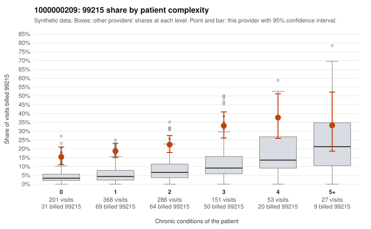

# 1000000209: 1000000209: too few returned records to judge

**Leaning (advisory):** Inconclusive

## Why

1000000209 billed 99215 on 22.4% of 1,086 claims against an expected 5.6% given patient complexity (risk-adjusted score 8.96; plain z-score vs peers 2.46). 41% of this provider's 99215 claims were on patients with 0 or 1 chronic conditions. Records came back for 30 claims. Of 7 documented 99215 claims, 3 (43%) were documented below the billed level, against 20% for the comparison providers. Note checks on 30 returned notes (share showing each sign): problems 13%, late 3%, unsigned 0%, data 10%. No audit trail was received. 3 of 13 notes claiming moderate-or-higher data reviewed had no lab or test line on the claim. The evidence does not support a call either way yet. Examples: C0100148: billed 99215; documented MDM level moderate, 34 minutes. C0100434: billed 99215; documented MDM level moderate, 33 minutes. C0099995: billed 99215, patient aged 52 with 0 chronic condition(s). C0100029: billed 99215, patient aged 81 with 1 chronic condition(s) (hyperlipidemia).

## Evidence chart

## Cited claims

`C0100148`, `C0100434`, `C0099995`, `C0100029`

## Suggested next steps

- 30 charts came back but do not settle it: request a targeted sample of 99215 charts, starting with C0100148, C0100434, C0099995.
- Re-check after the targeted charts arrive; do not call upcoding or a sicker panel on this evidence alone.

---
Citations checked: 4/4 valid. Synthetic data. The leaning is advisory; the flag comes from the statistical screen, and no clinical documentation is available beyond the sampled records-review facts shown in the packet.
