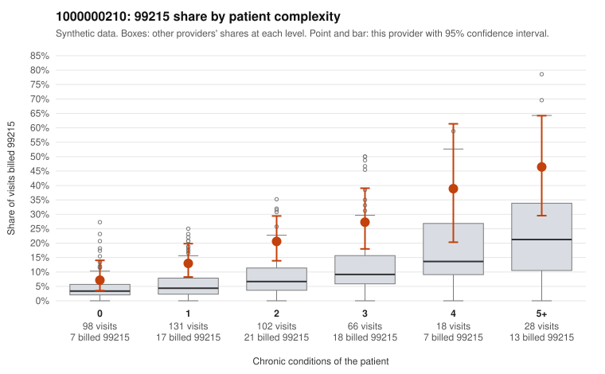

# 1000000210: 1000000210: too few returned records to judge

**Leaning (advisory):** Inconclusive

## Why

1000000210 billed 99215 on 18.7% of 443 claims against an expected 6.0% given patient complexity (risk-adjusted score 4.11; plain z-score vs peers 1.85). 29% of this provider's 99215 claims were on patients with 0 or 1 chronic conditions. Records came back for 44 claims. Of 19 documented 99215 claims, 5 (26%) were documented below the billed level, against 20% for the comparison providers. Note checks on 44 returned notes (share showing each sign): problems 14%, late 9%, unsigned 0%, data 0%. No audit trail was received. 0 of 36 notes claiming moderate-or-higher data reviewed had no lab or test line on the claim. The evidence does not support a call either way yet. Examples: C0101152: billed 99215; documented MDM level moderate, minutes not recorded. C0101160: billed 99215, patient aged 35 with 1 chronic condition(s) (type 2 diabetes); documented MDM level moderate, minutes not recorded. C0100980: billed 99215, patient aged 24 with 1 chronic condition(s) (hypertension). C0101006: billed 99215, patient aged 64 with 1 chronic condition(s) (heart failure).

## Evidence chart

## Cited claims

`C0101152`, `C0101160`, `C0100980`, `C0101006`

## Suggested next steps

- 44 charts came back but do not settle it: request a targeted sample of 99215 charts, starting with C0101152, C0101160, C0100980.
- Re-check after the targeted charts arrive; do not call upcoding or a sicker panel on this evidence alone.

---
Citations checked: 4/4 valid. Synthetic data. The leaning is advisory; the flag comes from the statistical screen, and no clinical documentation is available beyond the sampled records-review facts shown in the packet.
