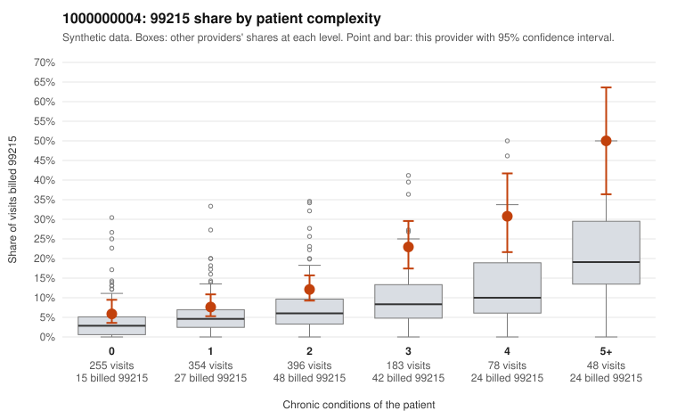

# 1000000004: 1000000004: documented 99215 claims mostly support the level billed (12% below)

**Leaning (advisory):** Pattern consistent with a high-acuity panel

## Why

1000000004 billed 99215 on 13.7% of 1,314 claims against an expected 5.9% given patient complexity (risk-adjusted score 4.83; plain z-score vs peers 1.24). 23% of this provider's 99215 claims were on patients with 0 or 1 chronic conditions. Records came back for 45 claims. Of 17 documented 99215 claims, 2 (12%) were documented below the billed level, against 32% for the comparison providers. Note checks on 45 returned notes (share showing each sign): problems 20%, late 4%, unsigned 0%, data 0%. No audit trail was received. 0 of 35 notes claiming moderate-or-higher data reviewed had no lab or test line on the claim. This pattern is consistent with a high-acuity panel. The sampled documentation supports the billed level. Examples: C0002860: billed 99215, patient aged 43 with 5 chronic condition(s) (obesity;hyperlipidemia;hypertension;COPD;asthma); documented MDM level high, minutes not recorded. C0002963: billed 99215, patient aged 29 with 1 chronic condition(s) (hypothyroidism); documented MDM level high, 33 minutes. C0003206: billed 99215; documented MDM level high, 49 minutes. C0002623: billed 99215, patient aged 63 with 4 chronic condition(s) (hyperlipidemia;hypertension;asthma;chronic kidney disease).

## Evidence chart

## Cited claims

`C0002860`, `C0002963`, `C0003206`, `C0002623`

## Suggested next steps

- Do not pursue recovery on this evidence: 45 charts came back and they support the level billed (2 of 17 documented 99215 claims below the billed level).
- Revisit if the 99215 share keeps rising against peers or a larger sample shows unsupported claims.

---
Citations checked: 4/4 valid. Synthetic data. The leaning is advisory; the flag comes from the statistical screen, and no clinical documentation is available beyond the sampled records-review facts shown in the packet.
