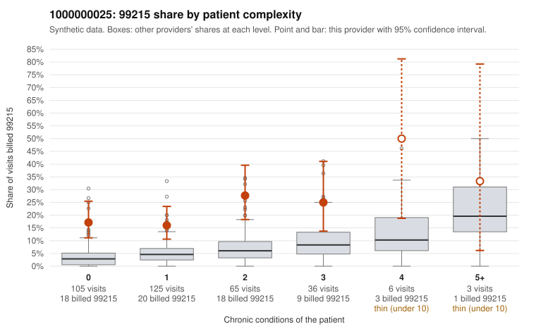

# 1000000025: 1000000025: 3 of 6 documented 99215 claims (50%) are documented below the billed level

**Leaning (advisory):** Pattern consistent with upcoding

## Why

1000000025 billed 99215 on 20.3% of 340 claims against an expected 4.7% given patient complexity (risk-adjusted score 5.39; plain z-score vs peers 2.46). 55% of this provider's 99215 claims were on patients with 0 or 1 chronic conditions. Records came back for 29 claims. Of 6 documented 99215 claims, 3 (50%) were documented below the billed level, against 32% for the comparison providers. Note checks on 29 returned notes (share showing each sign): problems 24%, late 7%, unsigned 0%, data 3%. No audit trail was received. 2 of 20 notes claiming moderate-or-higher data reviewed had no lab or test line on the claim. This pattern is consistent with upcoding. It is a reason to review the records, not a finding. Examples: C0013506: billed 99215, patient aged 52 with 1 chronic condition(s) (type 2 diabetes); documented MDM level moderate, 36 minutes. C0013704: billed 99215, patient aged 41 with 1 chronic condition(s) (heart failure); documented MDM level low, minutes not recorded. C0013750: billed 99215; documented MDM level moderate, 31 minutes. C0013465: billed 99215, patient aged 34 with 1 chronic condition(s) (type 2 diabetes). C0013467: billed 99215, patient aged 28 with 1 chronic condition(s) (hypothyroidism). C0013483: billed 99215, patient aged 56 with 1 chronic condition(s) (hyperlipidemia).

## Evidence chart

## Cited claims

`C0013506`, `C0013704`, `C0013750`, `C0013465`, `C0013467`, `C0013483`

## Suggested next steps

- Request the full charts for C0013506, C0013704, C0013750 and have a certified coder re-score each against the current E/M rules (medical decision making or total time).
- If the re-scoring confirms the pattern, review the random sample in the recovery packet's sampling plan before any overpayment estimate; do not extrapolate from a targeted sample.
- Look at the notes themselves: 24% address fewer problems than their level implies and 7% were signed late; request the audit trail for C0013506, C0013704, C0013750.

---
Citations checked: 6/6 valid. Synthetic data. The leaning is advisory; the flag comes from the statistical screen, and no clinical documentation is available beyond the sampled records-review facts shown in the packet.
