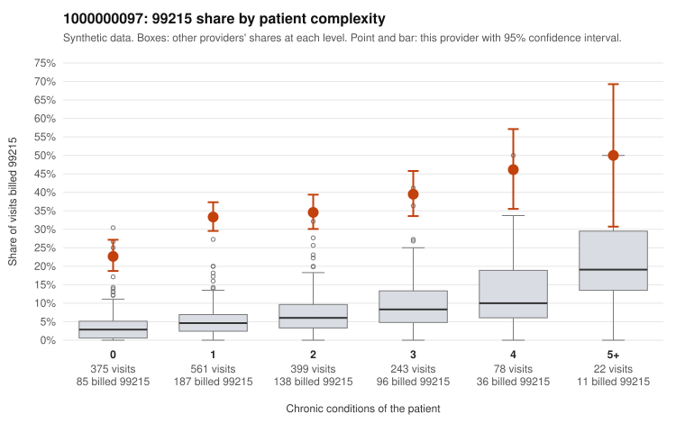

# 1000000097: 1000000097: too few returned records to judge

**Leaning (advisory):** Inconclusive

## Why

1000000097 billed 99215 on 33.0% of 1,678 claims against an expected 5.3% given patient complexity (risk-adjusted score 20.28; plain z-score vs peers 4.81). 49% of this provider's 99215 claims were on patients with 0 or 1 chronic conditions. Records came back for 21 claims. Of 17 documented 99215 claims, 1 (6%) were documented below the billed level, against 32% for the comparison providers. Note checks on 21 returned notes (share showing each sign): problems 29%, late 19%, unsigned 0%, data 5%. No audit trail was received. 2 of 18 notes claiming moderate-or-higher data reviewed had no lab or test line on the claim. The evidence does not support a call either way yet. Examples: C0048670: billed 99215; documented MDM level moderate, minutes not recorded. C0046999: billed 99215, patient aged 79 with 1 chronic condition(s) (hyperlipidemia). C0047049: billed 99215, patient aged 44 with 0 chronic condition(s).

## Evidence chart

## Cited claims

`C0048670`, `C0046999`, `C0047049`

## Suggested next steps

- 21 charts came back but do not settle it: request a targeted sample of 99215 charts, starting with C0048670, C0046999, C0047049.
- Re-check after the targeted charts arrive; do not call upcoding or a sicker panel on this evidence alone.

---
Citations checked: 3/3 valid. Synthetic data. The leaning is advisory; the flag comes from the statistical screen, and no clinical documentation is available beyond the sampled records-review facts shown in the packet.
