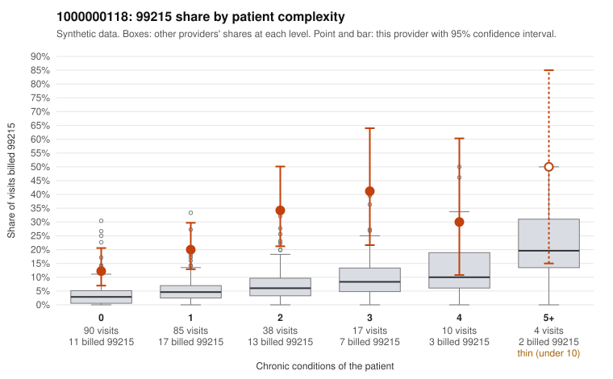

# 1000000118: 1000000118: too few returned records to judge

**Leaning (advisory):** Inconclusive

## Why

1000000118 billed 99215 on 21.7% of 244 claims against an expected 4.7% given patient complexity (risk-adjusted score 4.97; plain z-score vs peers 2.73). 53% of this provider's 99215 claims were on patients with 0 or 1 chronic conditions. Records came back for 29 claims. Of 6 documented 99215 claims, 0 (0%) were documented below the billed level, against 32% for the comparison providers. Note checks on 29 returned notes (share showing each sign): problems 17%, late 7%, unsigned 0%, data 10%. No audit trail was received. 3 of 18 notes claiming moderate-or-higher data reviewed had no lab or test line on the claim. The evidence does not support a call either way yet. Examples: C0055792: billed 99213; documented MDM level straightforward, minutes not recorded. C0055895: billed 99213; documented MDM level straightforward, 18 minutes. C0055797: billed 99215, patient aged 35 with 0 chronic condition(s). C0055807: billed 99215, patient aged 26 with 1 chronic condition(s) (obesity).

## Evidence chart

## Cited claims

`C0055792`, `C0055895`, `C0055797`, `C0055807`

## Suggested next steps

- 29 charts came back but do not settle it: request a targeted sample of 99215 charts, starting with C0055792, C0055895, C0055797.
- Re-check after the targeted charts arrive; do not call upcoding or a sicker panel on this evidence alone.

---
Citations checked: 4/4 valid. Synthetic data. The leaning is advisory; the flag comes from the statistical screen, and no clinical documentation is available beyond the sampled records-review facts shown in the packet.
