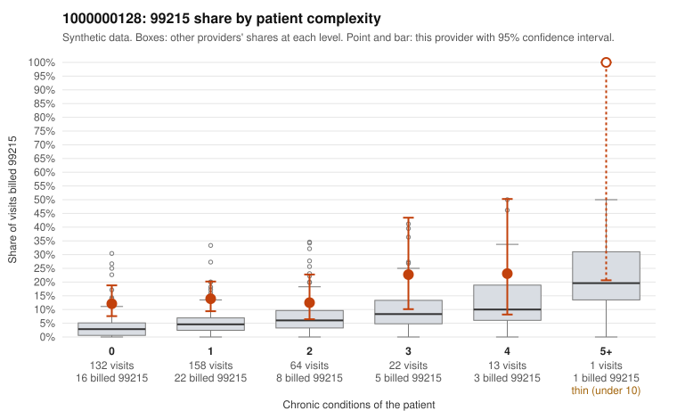

# Payment Integrity dossier: 1000000128

> Draft for human review. Statistical and records-sample evidence only; not a finding. Compliance or legal review is needed before any provider contact, notice or recoupment.

## Provider overview

| | |
|---|---|
| Specialty / state | Family Practice, GA (synthetic) |
| Claims / patients | 390 / 191 |
| Billed mix (99211 to 99215) | 4 / 3 / 125 / 203 / 55 |
| 99215 share | 14.1% |
| Expected 99215 share given patient complexity | 4.5% |
| Screen scores | z vs peers 1.31; risk-adjusted 3.65; flagged by eb_ratio |

## Case summary (advisory)

**1000000128: 6 of 7 documented 99215 claims (86%) are documented below the billed level**

Leaning: pattern consistent with upcoding. Citations checked: 6/6 valid.

1000000128 billed 99215 on 14.1% of 390 claims against an expected 4.5% given patient complexity (risk-adjusted score 3.65; plain z-score vs peers 1.31). 69% of this provider's 99215 claims were on patients with 0 or 1 chronic conditions. Records came back for 30 claims. Of 7 documented 99215 claims, 6 (86%) were documented below the billed level, against 32% for the comparison providers. Note checks on 30 returned notes (share showing each sign): problems 20%, late 10%, unsigned 0%, data 3%. No audit trail was received. 1 of 16 notes claiming moderate-or-higher data reviewed had no lab or test line on the claim. This pattern is consistent with upcoding. It is a reason to review the records, not a finding. Examples: C0062232: billed 99215, patient aged 18 with 1 chronic condition(s) (hypothyroidism); documented MDM level moderate, minutes not recorded. C0062341: billed 99215; documented MDM level moderate, 32 minutes. C0062351: billed 99215, patient aged 62 with 0 chronic condition(s); documented MDM level moderate, 39 minutes. C0062047: billed 99215, patient aged 54 with 1 chronic condition(s) (hyperlipidemia). C0062054: billed 99215, patient aged 73 with 0 chronic condition(s). C0062076: billed 99215, patient aged 44 with 1 chronic condition(s) (atrial fibrillation).

## Evidence chart

## Records-review sample so far

Documentation is on file for 30 claims (8% of this provider's claims).

| Billed | Documented | Documentation below billed level | Rate | All-provider rate |
|---|---|---|---|---|
| 99213 | 14 | 1 | 7.1% | 1.1% |
| 99214 | 9 | 0 | 0.0% | 5.6% |
| 99215 | 7 | 6 | 85.7% | 32.1% |

## Recommended next steps for Payment Integrity

1. Request records for the sampled claims in `record_request_list.csv` (31 claims across 99215).
2. Review the records against E/M documentation rules and record the supported level for each claim.
3. Run the overpayment estimator on the reviewed sample (`sampling_plan.md` explains how).
4. Notice, appeal rights, recoupment, education or corrective action, and any referral are decisions for the PI team, compliance and counsel. Nothing here drafts those.

Suggested follow-ups from the case summary:

- Request the full charts for C0062232, C0062341, C0062351 and have a certified coder re-score each against the current E/M rules (medical decision making or total time).
- If the re-scoring confirms the pattern, review the random sample in the recovery packet's sampling plan before any overpayment estimate; do not extrapolate from a targeted sample.
- Look at the notes themselves: 20% address fewer problems than their level implies and 10% were signed late; request the audit trail for C0062232, C0062341, C0062351.

## Limits

- Synthetic data; no real claims or providers.
- The leaning is advisory. The flag comes from the statistical screen; the summary explains it.
- The records-review sample is partial and was simulated for this project.
- Allowed amounts are GA Family Practice averages from a public CMS file, not this provider's actual payments.
