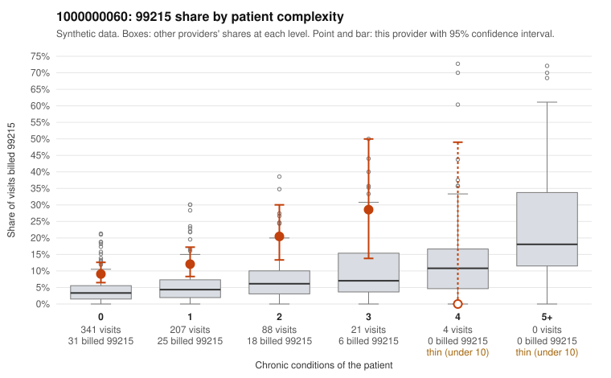

# 1000000060: 1000000060: too few returned records to judge

**Leaning (advisory):** Inconclusive

## Why

1000000060 billed 99215 on 12.1% of 661 claims against an expected 3.5% given patient complexity (risk-adjusted score 4.05; plain z-score vs peers 0.83). 70% of this provider's 99215 claims were on patients with 0 or 1 chronic conditions. Records came back for 45 claims. Of 15 documented 99215 claims, 1 (7%) were documented below the billed level, against 38% for the comparison providers. Note checks on 45 returned notes (share showing each sign): problems 47%, late 4%, unsigned 0%, data 2%. No audit trail was received. 1 of 31 notes claiming moderate-or-higher data reviewed had no lab or test line on the claim. The evidence does not support a call either way yet. Examples: C0034696: billed 99215, patient aged 29 with 0 chronic condition(s); documented MDM level moderate, 34 minutes. C0034590: billed 99215, patient aged 73 with 0 chronic condition(s). C0034594: billed 99215, patient aged 36 with 0 chronic condition(s).

## Evidence chart

## Cited claims

`C0034696`, `C0034590`, `C0034594`

## Suggested next steps

- 45 charts came back but do not settle it: request a targeted sample of 99215 charts, starting with C0034696, C0034590, C0034594.
- Re-check after the targeted charts arrive; do not call upcoding or a sicker panel on this evidence alone.

---
Citations checked: 3/3 valid. Synthetic data. The leaning is advisory; the flag comes from the statistical screen, and no clinical documentation is available beyond the sampled records-review facts shown in the packet.
