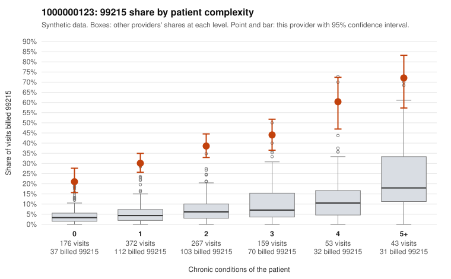

# 1000000123: 1000000123: 1 of 19 documented 99215 claims (5%) are documented below the billed level

**Leaning (advisory):** Pattern consistent with upcoding

## Why

1000000123 billed 99215 on 36.0% of 1,070 claims against an expected 4.9% given patient complexity (risk-adjusted score 16.56; plain z-score vs peers 4.82). 39% of this provider's 99215 claims were on patients with 0 or 1 chronic conditions. Records came back for 21 claims. Of 19 documented 99215 claims, 1 (5%) were documented below the billed level, against 38% for the comparison providers. Note checks on 21 returned notes (share showing each sign): problems 43%, late 14%, unsigned 0%, data 10%. No audit trail was received. 2 of 17 notes claiming moderate-or-higher data reviewed had no lab or test line on the claim. This pattern is consistent with upcoding. It is a reason to review the records, not a finding. Examples: C0061936: billed 99215; documented MDM level moderate, minutes not recorded. C0060959: billed 99215, patient aged 36 with 0 chronic condition(s). C0061020: billed 99215, patient aged 61 with 0 chronic condition(s). C0061110: billed 99215, patient aged 52 with 1 chronic condition(s) (hyperlipidemia).

## Evidence chart

## Cited claims

`C0061936`, `C0060959`, `C0061020`, `C0061110`

## Suggested next steps

- Request the full charts for C0061936, C0060959, C0061020 and have a certified coder re-score each against the current E/M rules (medical decision making or total time).
- If the re-scoring confirms the pattern, review the random sample in the recovery packet's sampling plan before any overpayment estimate; do not extrapolate from a targeted sample.
- Look at the notes themselves: 43% address fewer problems than their level implies and 14% were signed late; request the audit trail for C0061936, C0060959, C0061020.

---
Citations checked: 4/4 valid. Synthetic data. The leaning is advisory; the flag comes from the statistical screen, and no clinical documentation is available beyond the sampled records-review facts shown in the packet.
