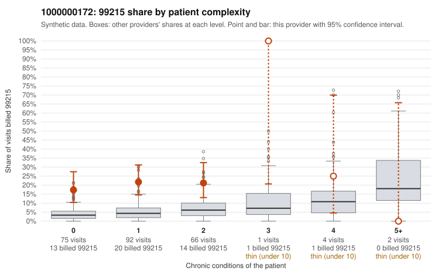

# 1000000172: 1000000172: too few returned records to judge

**Leaning (advisory):** Inconclusive

## Why

1000000172 billed 99215 on 20.4% of 240 claims against an expected 3.9% given patient complexity (risk-adjusted score 4.47; plain z-score vs peers 2.22). 67% of this provider's 99215 claims were on patients with 0 or 1 chronic conditions. Records came back for 29 claims. Of 10 documented 99215 claims, 1 (10%) were documented below the billed level, against 38% for the comparison providers. Note checks on 29 returned notes (share showing each sign): problems 28%, late 24%, unsigned 0%, data 10%. No audit trail was received. 4 of 23 notes claiming moderate-or-higher data reviewed had no lab or test line on the claim. The evidence does not support a call either way yet. Examples: C0088898: billed 99215, patient aged 39 with 1 chronic condition(s) (hypertension); documented MDM level moderate, minutes not recorded. C0088682: billed 99215, patient aged 48 with 0 chronic condition(s). C0088685: billed 99215, patient aged 49 with 0 chronic condition(s).

## Evidence chart

## Cited claims

`C0088898`, `C0088682`, `C0088685`

## Suggested next steps

- 29 charts came back but do not settle it: request a targeted sample of 99215 charts, starting with C0088898, C0088682, C0088685.
- Re-check after the targeted charts arrive; do not call upcoding or a sicker panel on this evidence alone.

---
Citations checked: 3/3 valid. Synthetic data. The leaning is advisory; the flag comes from the statistical screen, and no clinical documentation is available beyond the sampled records-review facts shown in the packet.
