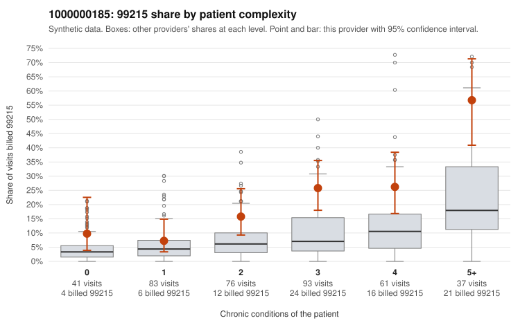

# 1000000185: 1000000185: too few returned records to judge

**Leaning (advisory):** Inconclusive

## Why

1000000185 billed 99215 on 21.2% of 391 claims against an expected 6.3% given patient complexity (risk-adjusted score 4.12; plain z-score vs peers 2.35). 12% of this provider's 99215 claims were on patients with 0 or 1 chronic conditions. Records came back for 30 claims. Of 8 documented 99215 claims, 1 (12%) were documented below the billed level, against 38% for the comparison providers. Note checks on 30 returned notes (share showing each sign): problems 13%, late 3%, unsigned 0%, data 7%. No audit trail was received. 2 of 26 notes claiming moderate-or-higher data reviewed had no lab or test line on the claim. The evidence does not support a call either way yet. Examples: C0095585: billed 99215; documented MDM level moderate, minutes not recorded. C0095554: billed 99215, patient aged 40 with 0 chronic condition(s). C0095582: billed 99215, patient aged 53 with 1 chronic condition(s) (obesity).

## Evidence chart

## Cited claims

`C0095585`, `C0095554`, `C0095582`

## Suggested next steps

- 30 charts came back but do not settle it: request a targeted sample of 99215 charts, starting with C0095585, C0095554, C0095582.
- Re-check after the targeted charts arrive; do not call upcoding or a sicker panel on this evidence alone.

---
Citations checked: 3/3 valid. Synthetic data. The leaning is advisory; the flag comes from the statistical screen, and no clinical documentation is available beyond the sampled records-review facts shown in the packet.
