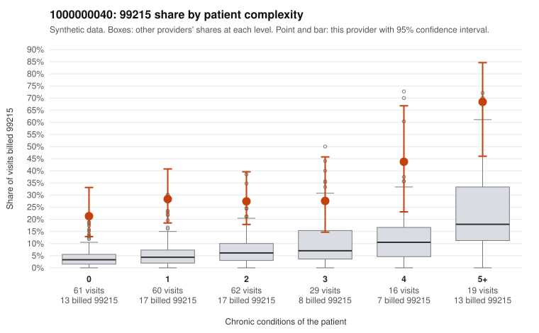

# Payment Integrity dossier: 1000000040

> Draft for human review. Statistical and records-sample evidence only; not a finding. Compliance or legal review is needed before any provider contact, notice or recoupment.

## Provider overview

| | |
|---|---|
| Specialty / state | Family Practice, GA (synthetic) |
| Claims / patients | 247 / 127 |
| Billed mix (99211 to 99215) | 0 / 3 / 45 / 124 / 75 |
| 99215 share | 30.4% |
| Expected 99215 share given patient complexity | 5.3% |
| Screen scores | z vs peers 3.88; risk-adjusted 6.11; flagged by eb_ratio |

## Case summary (advisory)

**1000000040: 9 of 10 documented 99215 claims (90%) are documented below the billed level**

Leaning: pattern consistent with upcoding. Citations checked: 6/6 valid.

1000000040 billed 99215 on 30.4% of 247 claims against an expected 5.3% given patient complexity (risk-adjusted score 6.11; plain z-score vs peers 3.88). 40% of this provider's 99215 claims were on patients with 0 or 1 chronic conditions. Records came back for 29 claims. Of 10 documented 99215 claims, 9 (90%) were documented below the billed level, against 38% for the comparison providers. Note checks on 29 returned notes (share showing each sign): problems 31%, late 3%, unsigned 0%, data 7%. No audit trail was received. 2 of 20 notes claiming moderate-or-higher data reviewed had no lab or test line on the claim. This pattern is consistent with upcoding. It is a reason to review the records, not a finding. Examples: C0025086: billed 99215, patient aged 62 with 4 chronic condition(s) (hypothyroidism;obesity;depression;hypertension); documented MDM level moderate, 32 minutes. C0025105: billed 99215; documented MDM level moderate, 32 minutes. C0025136: billed 99215; documented MDM level moderate, 37 minutes. C0025079: billed 99215, patient aged 54 with 0 chronic condition(s). C0025099: billed 99215, patient aged 69 with 1 chronic condition(s) (hypertension). C0025123: billed 99215, patient aged 60 with 1 chronic condition(s) (osteoarthritis).

## Evidence chart

## Records-review sample so far

Documentation is on file for 29 claims (12% of this provider's claims).

| Billed | Documented | Documentation below billed level | Rate | All-provider rate |
|---|---|---|---|---|
| 99213 | 7 | 0 | 0.0% | 3.4% |
| 99214 | 12 | 2 | 16.7% | 8.3% |
| 99215 | 10 | 9 | 90.0% | 37.9% |

## Recommended next steps for Payment Integrity

1. Request records for the sampled claims in `record_request_list.csv` (36 claims across 99215).
2. Review the records against E/M documentation rules and record the supported level for each claim.
3. Run the overpayment estimator on the reviewed sample (`sampling_plan.md` explains how).
4. Notice, appeal rights, recoupment, education or corrective action, and any referral are decisions for the PI team, compliance and counsel. Nothing here drafts those.

Suggested follow-ups from the case summary:

- Request the full charts for C0025086, C0025105, C0025136 and have a certified coder re-score each against the current E/M rules (medical decision making or total time).
- If the re-scoring confirms the pattern, review the random sample in the recovery packet's sampling plan before any overpayment estimate; do not extrapolate from a targeted sample.
- Look at the notes themselves: 31% address fewer problems than their level implies and 3% were signed late; request the audit trail for C0025086, C0025105, C0025136.

## Limits

- Synthetic data; no real claims or providers.
- The leaning is advisory. The flag comes from the statistical screen; the summary explains it.
- The records-review sample is partial and was simulated for this project.
- Allowed amounts are GA Family Practice averages from a public CMS file, not this provider's actual payments.
