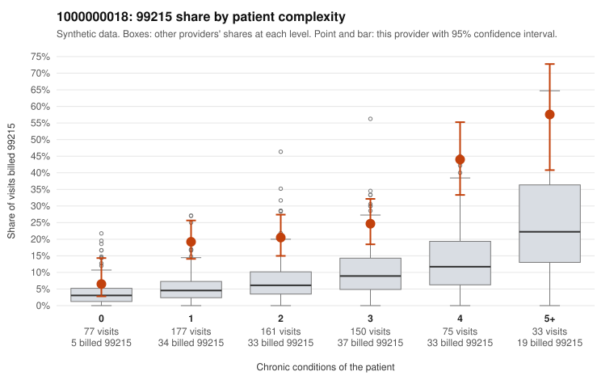

# 1000000018: 1000000018: too few returned records to judge

**Leaning (advisory):** Inconclusive

## Why

1000000018 billed 99215 on 23.9% of 673 claims against an expected 6.7% given patient complexity (risk-adjusted score 6.86; plain z-score vs peers 2.79). 24% of this provider's 99215 claims were on patients with 0 or 1 chronic conditions. Records came back for 30 claims. Of 8 documented 99215 claims, 1 (12%) were documented below the billed level, against 54% for the comparison providers. Note checks on 30 returned notes (share showing each sign): problems 10%, late 10%, unsigned 0%, data 10%. No audit trail was received. 3 of 18 notes claiming moderate-or-higher data reviewed had no lab or test line on the claim. The evidence does not support a call either way yet. Examples: C0008899: billed 99215; documented MDM level low, minutes not recorded. C0008297: billed 99215, patient aged 40 with 0 chronic condition(s). C0008309: billed 99215, patient aged 38 with 1 chronic condition(s) (hypertension).

## Evidence chart

## Cited claims

`C0008899`, `C0008297`, `C0008309`

## Suggested next steps

- 30 charts came back but do not settle it: request a targeted sample of 99215 charts, starting with C0008899, C0008297, C0008309.
- Re-check after the targeted charts arrive; do not call upcoding or a sicker panel on this evidence alone.

---
Citations checked: 3/3 valid. Synthetic data. The leaning is advisory; the flag comes from the statistical screen, and no clinical documentation is available beyond the sampled records-review facts shown in the packet.
