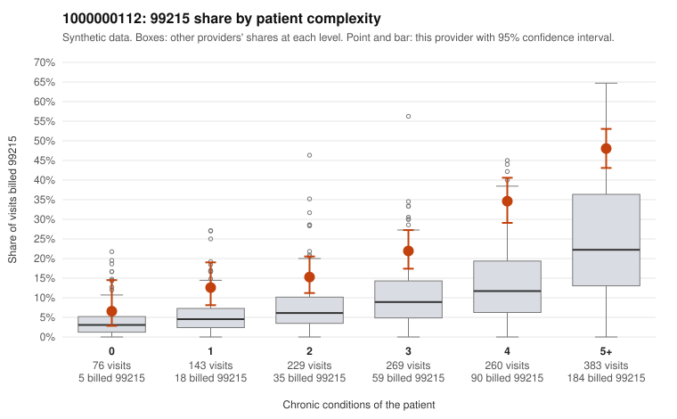

# 1000000112: 1000000112: documented 99215 claims mostly support the level billed (10% below)

**Leaning (advisory):** Pattern consistent with a high-acuity panel

## Why

1000000112 billed 99215 on 28.7% of 1,360 claims against an expected 11.0% given patient complexity (risk-adjusted score 8.16; plain z-score vs peers 3.61). 6% of this provider's 99215 claims were on patients with 0 or 1 chronic conditions. Records came back for 30 claims. Of 10 documented 99215 claims, 1 (10%) were documented below the billed level, against 54% for the comparison providers. Note checks on 30 returned notes (share showing each sign): problems 3%, late 0%, unsigned 0%, data 3%. No audit trail was received. 1 of 20 notes claiming moderate-or-higher data reviewed had no lab or test line on the claim. This pattern is consistent with a high-acuity panel. The sampled documentation supports the billed level. Examples: C0062638: billed 99215; documented MDM level high, minutes not recorded. C0062715: billed 99215; documented MDM level high, minutes not recorded. C0062953: billed 99215; documented MDM level high, 42 minutes. C0062604: billed 99215, patient aged 54 with 4 chronic condition(s) (type 2 diabetes;hypertension;COPD;chronic kidney disease). C0062665: billed 99215, patient aged 72 with 5 chronic condition(s) (depression;hypertension;atrial fibrillation;asthma;chronic kidney disease).

## Evidence chart

## Cited claims

`C0062638`, `C0062715`, `C0062953`, `C0062604`, `C0062665`

## Suggested next steps

- Do not pursue recovery on this evidence: 30 charts came back and they support the level billed (1 of 10 documented 99215 claims below the billed level).
- Revisit if the 99215 share keeps rising against peers or a larger sample shows unsupported claims.

---
Citations checked: 5/5 valid. Synthetic data. The leaning is advisory; the flag comes from the statistical screen, and no clinical documentation is available beyond the sampled records-review facts shown in the packet.
