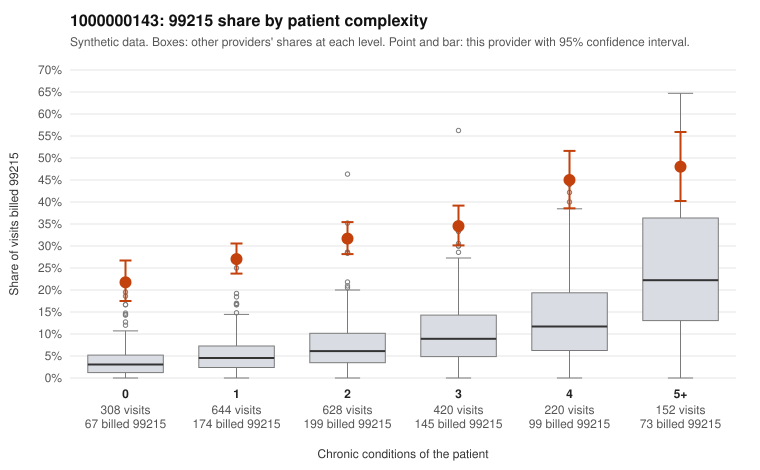

# 1000000143: 1000000143: too few returned records to judge

**Leaning (advisory):** Inconclusive

## Why

1000000143 billed 99215 on 31.9% of 2,372 claims against an expected 6.7% given patient complexity (risk-adjusted score 19.32; plain z-score vs peers 4.14). 32% of this provider's 99215 claims were on patients with 0 or 1 chronic conditions. Records came back for 30 claims. Of 9 documented 99215 claims, 6 (67%) were documented below the billed level, against 54% for the comparison providers. Note checks on 30 returned notes (share showing each sign): problems 13%, late 10%, unsigned 0%, data 3%. No audit trail was received. 3 of 24 notes claiming moderate-or-higher data reviewed had no lab or test line on the claim. The evidence does not support a call either way yet. Examples: C0077174: billed 99215; documented MDM level moderate, 32 minutes. C0077337: billed 99215; documented MDM level moderate, 36 minutes. C0076642: billed 99215, patient aged 38 with 0 chronic condition(s). C0076702: billed 99215, patient aged 36 with 0 chronic condition(s).

## Evidence chart

## Cited claims

`C0077174`, `C0077337`, `C0076642`, `C0076702`

## Suggested next steps

- 30 charts came back but do not settle it: request a targeted sample of 99215 charts, starting with C0077174, C0077337, C0076642.
- Re-check after the targeted charts arrive; do not call upcoding or a sicker panel on this evidence alone.

---
Citations checked: 4/4 valid. Synthetic data. The leaning is advisory; the flag comes from the statistical screen, and no clinical documentation is available beyond the sampled records-review facts shown in the packet.
