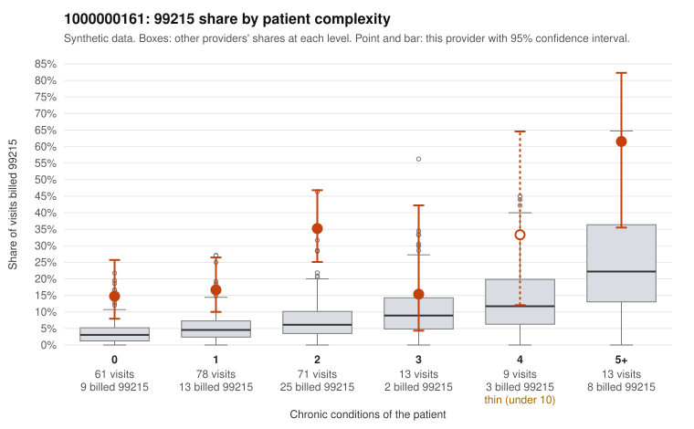

# 1000000161: 1000000161: too few returned records to judge

**Leaning (advisory):** Inconclusive

## Why

1000000161 billed 99215 on 24.5% of 245 claims against an expected 5.6% given patient complexity (risk-adjusted score 4.92; plain z-score vs peers 2.88). 37% of this provider's 99215 claims were on patients with 0 or 1 chronic conditions. Records came back for 45 claims. Of 19 documented 99215 claims, 1 (5%) were documented below the billed level, against 54% for the comparison providers. Note checks on 45 returned notes (share showing each sign): problems 31%, late 11%, unsigned 0%, data 11%. No audit trail was received. 6 of 37 notes claiming moderate-or-higher data reviewed had no lab or test line on the claim. The evidence does not support a call either way yet. Examples: C0092165: billed 99215, patient aged 51 with 0 chronic condition(s); documented MDM level moderate, minutes not recorded. C0091944: billed 99215, patient aged 45 with 1 chronic condition(s) (type 2 diabetes). C0091952: billed 99215, patient aged 40 with 0 chronic condition(s).

## Evidence chart

## Cited claims

`C0092165`, `C0091944`, `C0091952`

## Suggested next steps

- 45 charts came back but do not settle it: request a targeted sample of 99215 charts, starting with C0092165, C0091944, C0091952.
- Re-check after the targeted charts arrive; do not call upcoding or a sicker panel on this evidence alone.

---
Citations checked: 3/3 valid. Synthetic data. The leaning is advisory; the flag comes from the statistical screen, and no clinical documentation is available beyond the sampled records-review facts shown in the packet.
